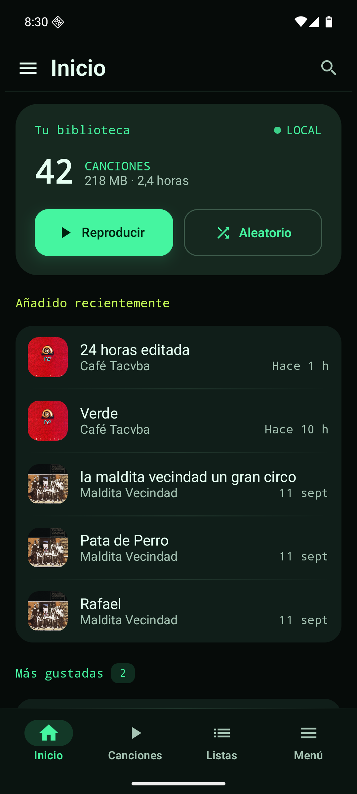
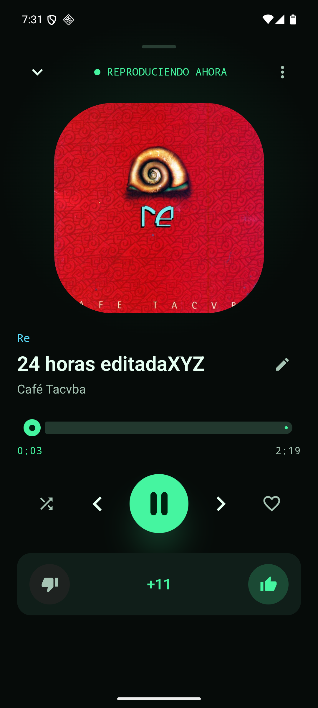
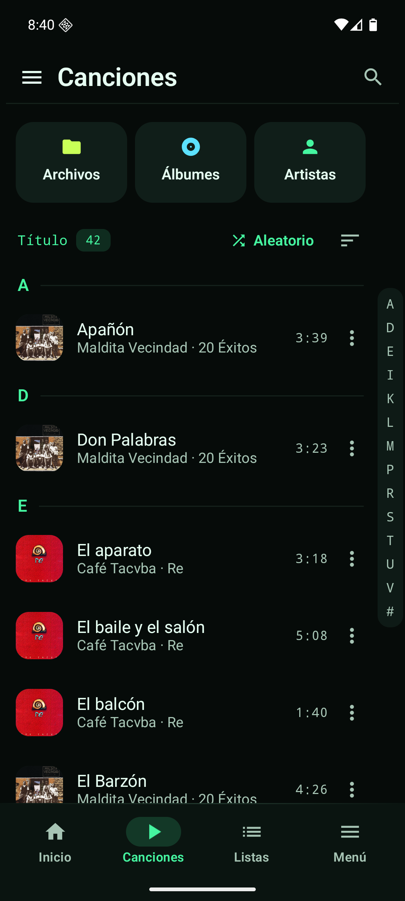
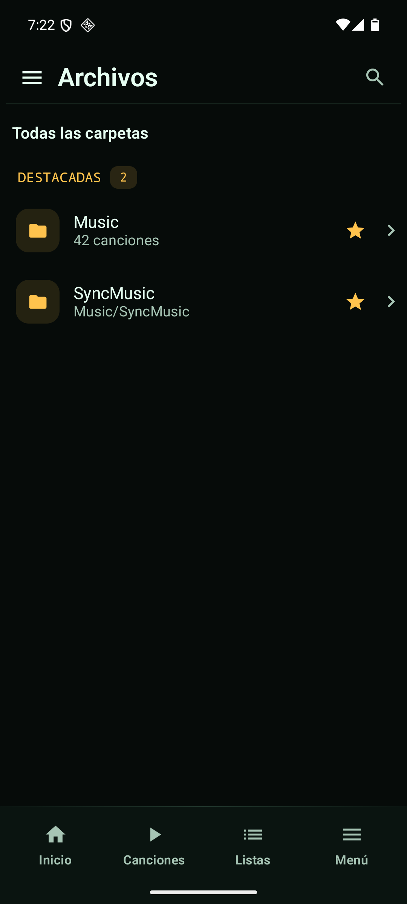
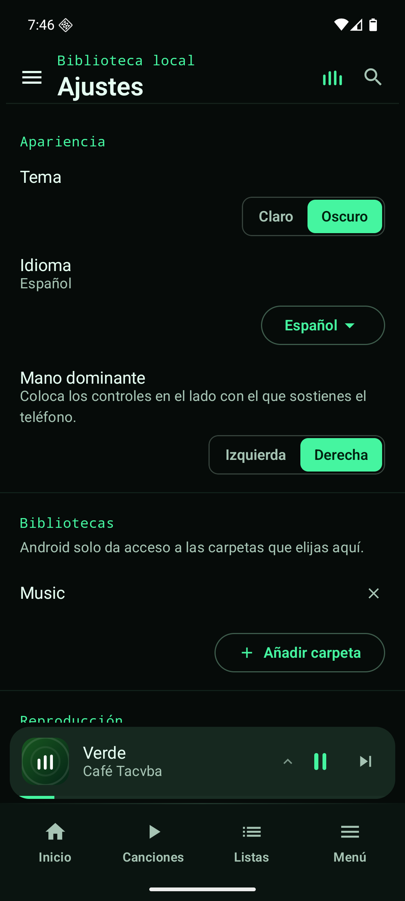
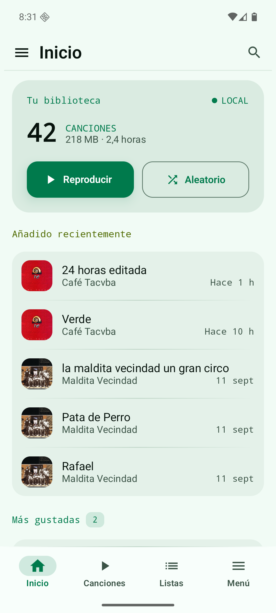
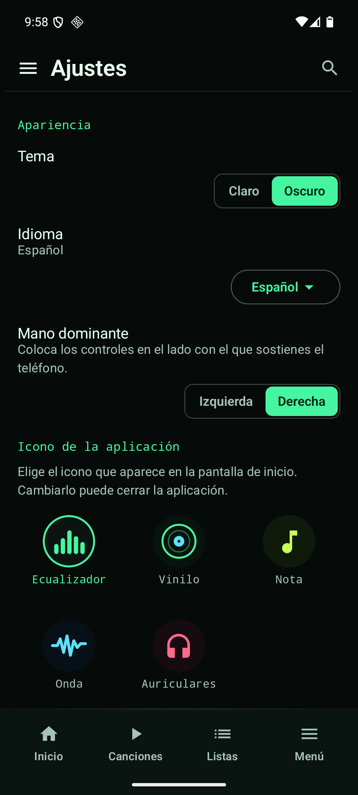

# Music Player

A local-first music player for Android, built with Kotlin and Jetpack Compose. Point it
at the folders that hold your music, and it scans, tags, browses and plays them — no
account, no upload, no network permission.



[](#requirements)
[](#tech-stack)
[](#tech-stack)
[](LICENSE)

[](https://github.com/mel1s4/music-player-app/actions/workflows/android.yml)

## Why this app

Most music players assume a cloud library, an account, or access to every file on the
device. This one assumes the opposite: you already own the files, Android's Storage
Access Framework gives the app access only to the folders you choose, and everything
the app knows stays on the phone.

The interface is the other half of the project: a dark, cyberpunk-green Material 3
theme with a deliberate typographic split — monospace for machine readouts (timecodes,
counts, kickers) and the system sans face for titles, artists and body copy. The design
notes, palette, contrast measurements and motion inventory are in
[docs/DESIGN.md](docs/DESIGN.md).

## Features

### Library

- **Multiple library folders** picked through the Storage Access Framework. No broad
  storage permission and no access to anything you did not explicitly grant.
- **Fast launches** — the last completed scan is painted immediately from the local
  metadata cache while a fresh scan runs behind it. A slim top-bar sweep shows the
  refresh; your library stays usable.
- **Incremental scanning** — file metadata is cached by URI, size and modification time,
  so only new or edited files are reopened. Deleted files are pruned from the cache.
- **Songs view** with title / artist / duration sorting, an alphabet rail, and a
  count badge.
- **Albums and artists** collected from track tags, with cover art and per-collection
  pages that open inside the tab (playback controls stay visible).
- **Files browser** with a scrollable breadcrumb, per-folder song counts, and
  **starred folders** pinned at the root for quick access.
- **Search** across tracks, albums and artists, with recent queries.

### Playback

- Background playback through a Media3 `MediaSessionService`, with notification and
  lock-screen controls.
- Queue playback, next/previous, seek and shuffle.
- **Weighted shuffle** that uses signed ratings: liked tracks are more likely, disliked
  ones less likely.
- Pause when headphones are unplugged and proper audio-focus handling.
- Persistent mini player and a full Now Playing screen.
- Swipe the **cover art** left/right to move to the next/previous track.

### Ratings, tags and metadata

- Signed integer ratings (neutral `0`) shown as icon-only thumbs; the score sets the
  weight used by shuffle.
- Favourites and free-form tags per track.
- Read and write real tags — ID3v2, Vorbis comments, MP4 atoms — through
  [jaudiotagger](https://github.com/jthink/jaudiotagger).
- Optional **write-through**: ratings, favourites and app tags can be mirrored into the
  audio file's own metadata, so they survive a reinstall and travel to other players.
- Rename files, edit title/artist/album/year/track/disc/genre/comment, and manage
  artwork.
- **Free up space** by transcoding tracks to AAC, with the option to replace the
  original or keep both.

### Interface

- Dark and light cyberpunk themes, both meeting WCAG AAA for body text.
- Five launcher icon styles (Equalizer, Vinyl, Note, Wave, Headphones).
- English, Spanish, French and Portuguese.
- Large text and reduced-motion friendly: animations are state-driven and stop when
  nothing is playing or scanning.
- Playlists: manual playlists plus dynamic playlists driven by a tag rule.

## Screenshots

| Now Playing | Songs |
|:--:|:--:|
|  |  |

| Files — starred folders | Settings |
|:--:|:--:|
|  |  |

| Light theme | App icons |
|:--:|:--:|
|  |  |

More screenshots, including the large-text and accessibility passes, live in
[docs/screenshots](docs/screenshots).

## Tech stack

| Layer | Choice |
|---|---|
| Language | Kotlin 2.2 |
| UI | Jetpack Compose, Material 3 |
| Playback | AndroidX Media3 (ExoPlayer + MediaSession) |
| Tag I/O | jaudiotagger |
| Persistence | SQLite (`library.db`), SharedPreferences for settings |
| File access | Storage Access Framework / `DocumentsContract` |
| Build | Gradle 9.9.1, AGP 9.5.1, JDK 17+ |
| Minimum SDK | 26 (Android 8.0) |
| Target SDK | 36 |

## Requirements

- **Android Studio** (latest stable) or a command-line Android SDK installation.
- **JDK 17 or newer.** Android Studio's bundled JDK works; on the command line set
  `JAVA_HOME` to it.
- **Android SDK Platform 36** and Build Tools 36.
- A device or emulator running **Android 8.0 (API 26)** or newer.

## Build and run

```bash
git clone https://github.com/mel1s4/music-player-app.git
cd music-player-app

# macOS/Linux
./gradlew :app:assembleDebug

# Windows
gradlew.bat :app:assembleDebug
```

Install the debug build:

```bash
adb install -r app/build/outputs/apk/debug/app-debug.apk
```

Or open the project folder in Android Studio, let Gradle sync, and press **Run**.

`local.properties` (which points at your SDK) is generated by Android Studio and is
git-ignored.

### Useful commands

```bash
./gradlew :app:lintDebug          # Android lint
./gradlew :app:assembleRelease    # minified release APK (R8)
```

The release build is unsigned by default. Configure your own signing key in Android
Studio (**Build → Generate Signed App Bundle / APK**) or via a local, git-ignored
`keystore.properties`. Never commit a keystore or its passwords.

### Continuous integration

Every push and pull request to `main` runs
[.github/workflows/android.yml](.github/workflows/android.yml):

1. Build the debug APK.
2. Run Android lint.
3. Build the minified release APK (R8) to catch shrinker issues.
4. Upload the debug APK as a workflow artifact.

## Project structure

```text
music-player-app/
├── app/
│   ├── src/main/java/dev/melisa/musicplayer/
│   │   ├── MainActivity.kt
│   │   ├── data/          # SAF scanning, SQLite, tags, artwork, compression
│   │   ├── playback/      # MediaSessionService and playback ownership
│   │   └── ui/            # Compose shell, screens, components, theme
│   ├── src/main/res/      # strings (en/es/fr/pt), drawables, launcher icons
│   └── build.gradle.kts
├── docs/
│   ├── DESIGN.md          # design system, palette, motion, architecture notes
│   └── screenshots/
├── gradle/
├── .github/               # CI, issue and pull-request templates
├── build.gradle.kts
├── settings.gradle.kts
└── gradlew
```

## How it works

- **Library access** goes through `DocumentsContract` tree URIs. The user picks a folder
  once; the app takes a persistable read/write grant, so no `READ_MEDIA_AUDIO` or
  `MANAGE_EXTERNAL_STORAGE` permission is needed.
- **Scanning** walks each granted tree with one cursor query per directory, then parses
  only files whose size or modification time changed. Parsed fields are cached in the
  `track_meta` table, which doubles as the launch snapshot.
- **Persistence** lives in `library.db` (SQLite): favourites, ratings, tags, playlists,
  first-seen timestamps, the metadata cache and starred folders. The database is
  migrated forward on upgrade; upgrading from any earlier schema is supported.
- **Playback** is owned by `PlaybackService`; the UI talks to it through a Media3
  `MediaController`. Audio keeps playing when the activity is gone.
- **File writes** (tag edits, ratings/favourites sync, renames) are copy → edit →
  write-back operations. The player reopens the current media item after a rewrite so
  the UI never claims to be playing a stale file handle.

Deeper design and data decisions are documented in [docs/DESIGN.md](docs/DESIGN.md).

## Data and privacy

The app does not request the `INTERNET` permission and has no analytics, accounts,
ads or telemetry. Your library, ratings, tags and playlists stay on the device.
`android:allowBackup="false"` keeps the database out of cloud backups.

Read [PRIVACY.md](PRIVACY.md) for the full data flow and the exact permissions used.

## Status and limitations

This is an early **0.1.0** release. The core flow is usable, but:

- Tests are not in place yet; CI currently covers build + lint. Contributions adding
  unit tests around scanning, tag I/O and rating weights are very welcome.
- Playable formats depend on the device's codecs (MP3, M4A/AAC, FLAC, OGG/Opus, WAV and
  WMA are recognised by the scanner).
- The library is device-local: no streaming, cloud sync or desktop companion.
- Android only.

Planned work is tracked in the issue tracker. See [CHANGELOG.md](CHANGELOG.md) for what
has shipped.

## Contributing

Contributions of all sizes are welcome — bug reports, translations, documentation,
tests and code. Please read [CONTRIBUTING.md](CONTRIBUTING.md) before opening a pull
request, and follow the [Code of Conduct](CODE_OF_CONDUCT.md).

- **Bugs / ideas:** use the issue templates.
- **Security issues:** do not open a public issue; follow [SECURITY.md](SECURITY.md).
- **Translations:** the app ships English, Spanish, French and Portuguese resources in
  `app/src/main/res/values*/strings.xml`.

## License

Released under the [MIT License](LICENSE).

Copyright © 2026 Melisa Villegas.

Third-party components and their licenses are listed in
[THIRD_PARTY_NOTICES.md](THIRD_PARTY_NOTICES.md). jaudiotagger is LGPL-licensed; it is
included unmodified and its source is linked from that file.

## Acknowledgements

- [AndroidX Media3](https://github.com/androidx/media) for playback and the media session.
- [Jetpack Compose](https://developer.android.com/jetpack/compose) and Material 3.
- [jaudiotagger](https://github.com/jthink/jaudiotagger) for tag reading and writing.
- [Contributor Covenant](https://www.contributor-covenant.org/) for the code of conduct.
- Everyone who files a bug or sends a translation.
