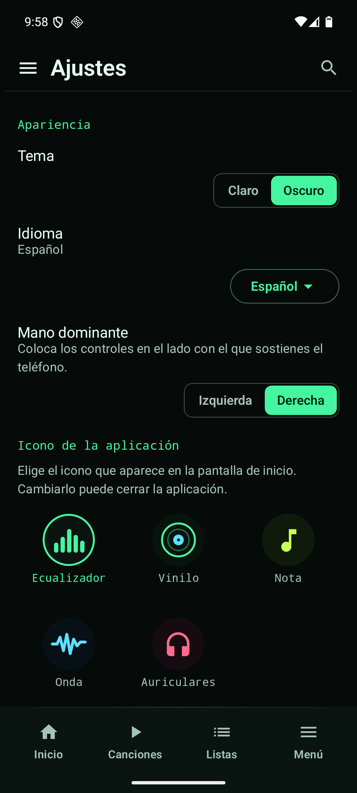
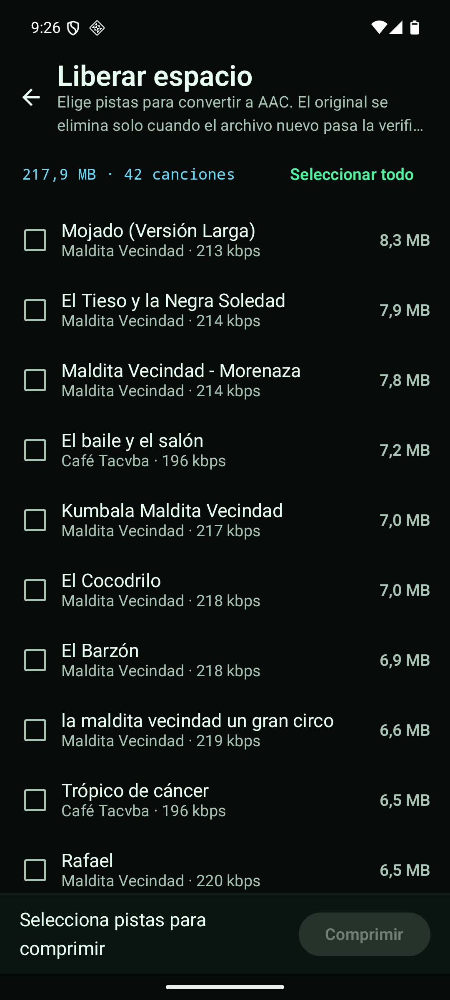

# Design notes — Music Player

[Back to README](../README.md)

## Cyberpunk Green UI redesign

A full visual and interaction redesign of the local music player (`dev.melisa.musicplayer`),
Jetpack Compose, Material 3. Kept as one shell around the existing playback, scanning,
tagging and playlist logic, plus a local database and best-effort file mirroring for the
data the user creates inside it.


---

## 1. The concept: "Grid runner"

The old UI was a clean but generic blue-and-white Material app. The new one is a
terminal you carry: layered green-black panels, mono readouts, and one electric green
that only ever means **"this is live"** or **"this is the action."**

Three rules keep it from turning into neon soup:

1. **Green is a state, not decoration.** It marks the playing track, the selected tab,
   the primary button, the live dot. Everything structural is desaturated green-grey,
   so the accent still reads at a glance.
2. **Mono is the machine voice; sans is the human voice.** Kickers, counters, timecodes
   and section labels are monospaced and wide-tracked. Titles, artists and body copy
   stay in the system sans face.
3. **Motion is physical.** Anything a finger touches squashes and springs. Anything the
   eye follows fades and slides in under 400 ms. Nothing loops on screen unless audio
   is actually moving.
4. **Chrome stays quiet.** Separation comes from surface tone and space, not from
   outlines: no 1dp neon frame around cards, no accent tick before every heading, no
   decorative glow behind panels. The only glow left is the transport button, because
   it marks the primary action.

---

## 2. Palette

### Dark — the default ("Night City")

| Role | Hex | Used for |
|---|---|---|
| Background / surface | `#060B09` | app canvas |
| Surface container | `#0D1915` | cards, panels |
| Surface container high | `#12231C` | mini player, raised cards |
| Primary (neon green) | `#45F5A0` | live state, primary action, focus |
| On primary | `#00210F` | text on green |
| Secondary (acid lime) | `#C9FF57` | ranks, playlist icons, song sections |
| Tertiary (cyan) | `#5CE1FF` | albums, artist sections |
| Error (magenta) | `#FF6B8B` | disliked, destructive, delete |
| On surface | `#E6FFF2` | primary text |
| On surface variant | `#A6C4B4` | secondary text |
| Outline variant | `#22382E` | hairlines |

Measured contrasts (WCAG 2.1):

| Pair | Ratio |
|---|---|
| Text `#E6FFF2` on `#060B09` | **18.8 : 1** (AAA) |
| Secondary text `#A6C4B4` on `#060B09` | **10.6 : 1** (AAA) |
| Green `#45F5A0` on `#060B09` | **14.0 : 1** (AAA) |
| `#00210F` on green | **12.1 : 1** (AAA) |
| Magenta `#FF6B8B` on `#060B09` | **7.3 : 1** (AAA) |

### Light — "Daylight"

The theme selector is a three-way **System / Light / Dark** control. System follows the
device's dark-mode setting and re-applies live when the device switches; Light and Dark
override it. The light palette still works because a neon panel becomes a mirror in a
bright kitchen. It is the same system in daylight: deep green ink on mint paper, no glow
effects.

| Pair | Ratio |
|---|---|
| Text `#07130D` on `#F1FBF5` | **17.9 : 1** |
| Secondary `#3B5346` on `#F1FBF5` | **7.9 : 1** |
| Green `#007A4C` on `#F1FBF5` | **5.1 : 1** |
| White on `#007A4C` | **5.4 : 1** |
| Magenta `#B3264A` on `#F1FBF5` | **6.0 : 1** |

---

## 3. Typography — sized for older eyes

Material's baseline (12sp captions, 14sp body) is the single most common complaint from
users over 50. Every size moved up one step, and the *smallest* text on screen is a
13sp monospaced label.

| Style | Size / line | Usage |
|---|---|---|
| Display small | 38 / 44 | the big library count |
| Headline small | 26 / 32 | screen title, Now Playing title |
| Title large | 23 / 30 | empty-state titles, settings labels |
| Body large | **17 / 26** | song titles, list content |
| Body medium | **16 / 24** | supporting copy |
| Body small | **14.5 / 21** | artist / album subtitles |
| Label large | 15 / 20 | buttons, nav labels |
| Label medium | 14 / 19, mono, +0.1 tracking | section labels, readouts |
| Label small | 13.5 / 18, mono, +0.2 tracking | counters, timecodes |

Line heights are generous (≈1.5) so two-line titles never collide.

---

## 4. Layout, shape, touch

- 8dp spacing base; 16–20dp screen gutters; 18–24dp between sections.
- Radii: 12 / 16 / 20 / 26dp. Panels use 20dp, artwork 16dp, chips 16dp.
- **Every interactive row is at least 68–78dp tall**; icon buttons are 44–52dp; the
  play/pause target is 76dp. Tags and filter chips are 44–48dp.
- Slider uses a custom **22dp disc thumb** with a soft glow instead of Material's 4dp
  hairline — the one control people drag with a thumb has to be hittable.
- Long lists keep a left rail + equalizer + colour + text to mark the current track, so
  state is never communicated by colour alone.

---

## 5. Motion inventory

| Interaction | Motion | Timing |
|---|---|---|
| Tab switch | 1/10-width slide + cross-fade | 260 ms in, 150 ms out |
| Album / artist / editor page | slide-over + fade, animated in *and* out | 260 / 150 ms |
| Drawer | slide from the holding hand's side + scrim fade | 260 / 150 ms |
| Now Playing | rises from the bottom, drag-down to dismiss | 400 ms spring |
| Mini player | expands up from the nav bar when a track starts | 260 ms |
| Artwork swipe | cover tracks the finger and rotates; direction pill slides out | follow + spring back |
| Play / pause | glyph morphs (scale + fade), button glows when playing | spring ≈ 300 ms |
| Buttons / rows / tabs | squash to 94–98% on press | spring 1200 stiffness |
| Nav tab | icon scales 1.1×, tint + pill animate, label follows | 150–260 ms |
| Track art | equalizer bars dance only while playing | 360–720 ms loop |
| Live dot | slow breathing alpha | 1.2 s loop |
| Scanning | green sweep across a rail | 900 ms loop |
| Score meters | fill animates from 0 on first draw | 400 ms |
| List reorder | LazyColumn placement animation | framework default |
| Cards / headers | staggered fade-and-rise on first display | 40 ms steps |

Reduced-motion note: all loops are tied to state (`playing`, `scanning`) and stop when
that state is false; no decorative animation runs forever on a static screen.

---

## 6. UX improvements

**Navigation**
- Album and artist pages open **inside the tab area** — under the top bar and above the
  mini player and bottom nav — so browsing a collection never hides playback controls or
  navigation. Only the full-screen editors (metadata, cover art) cover the chrome.
- Back from such a page returns to the index it was opened from, with the tabs intact.

**Player**
- Persistent mini player with artwork, title, live equalizer, progress LED bar, play and
  next — controls mirror to the holding hand (`Left` / `Right` in Settings).
- The progress control is a **waveform**, not a line: rounded bars show the RMS loudness
  of the decoded audio (72 buckets), with a vertical playhead and time labels. It sits on
  the lower edge of the cover art behind a dark scrim, in white so it reads over any
  artwork. Tap or drag anywhere on the bars to seek. Long tracks are sampled in 72 short windows so the envelope
  arrives quickly; short tracks decode in full, results stay in an in-memory cache, and
  a quiet placeholder keeps the control usable while analysis runs.
- Swipe the mini player up to open the player. Inside it, swipe **down** on the header
  or artwork to hide the player, and swipe **up** on either to open the song editor.
- Swipe the Now Playing artwork sideways to change song: left is next, right is previous. The
  cover tracks the finger (slight rotation and shrink) and the direction pill — “Next” or
  “Previous” — slides out from behind it. Past a short threshold the adjacent item plays;
  otherwise the cover springs back. Swipe always moves to the adjacent item, whereas the
  transport's previous button keeps the usual “restart if past 3 s” behaviour.
- Haptics on play, favourite and shuffle.
- **Notification and lock screen** are owned by the Media3 `MediaSessionService`: the
  MediaStyle notification and SystemUI controls read the same session. Every queue item
  carries `MediaMetadata` (title, artist, album), and the session has a launch
  `PendingIntent`, so tapping the notification or the lock-screen card opens the app.
- Android 13+ gates notifications behind `POST_NOTIFICATIONS`. The app asks once on
  launch (persisted in settings, so it is not repeated); **Settings → Playback
  notifications** opens the system notification page if the user changes their mind.
- Ratings start at **0**, move in **±1** steps and can go **negative**: the player shows
  the signed score between the thumbs, and the dashboard rows show only the tinted thumb.
  Negative scores are the disliked side; the weighted shuffle floors every non-positive
  score at the same minimum weight. Playlist and tag management live in the song lists,
  where there is a row to act on, not on the player.
- Ratings are **icon-only** everywhere (dashboard lists and the Now Playing score
  panel): a green thumb-up or magenta thumb-down, no "Liked"/"Disliked" words. The
  active side of the score panel fills with its colour; the inactive side stays muted.
  The phrase survives only as the icon's accessibility description. The player shows
  the score once, in that panel — there is no duplicate badge beside the artist; that
  slot belongs to the metadata pencil instead.
- The rating controls sit at the **top** of the Now Playing sheet, directly under the
  header and above the artwork, with no panel background, so the score and thumbs are
  visible without scrolling.
- When the current score is negative, two labelled tiles slide in above the thumbs:
  **Delete** (magenta, opens the file-deletion confirmation) and **Compress audio**
  (lime, opens the bitrate picker for that song). They are absent at neutral and
  positive scores, so maintenance stays out of the player until the user has actually
  marked the song as disliked.

**Dashboard**
- The Dashboard is the browse hub: a 2 × 2 grid of **Songs, Files, Albums and Artists**
  entries, each with its own accent and a large touch target. The library hero that
  used to sit here now tops the Songs page, next to the tracks it describes.
- **"Recently added" is the first list under the browse grid**: the five newest tracks
  with cover tile, artist and a locale-aware relative stamp ("hace 40 min", "11 sept").
  It is a preview, so the section carries no count badge.
- The first time a track URI is seen it is stamped in `LibraryExtras.addedAt`, seeded
  with the file's own modification time when the provider exposes it, and persisted.
  Rescans and tag edits never move an existing stamp; renames follow the file.
- **No "Continue listening" card**: the mini player already carries the current track
  and opens the full player, so a duplicate card above the lists would add nothing.
- Top-rated and disliked lists now show rank + a tinted thumb, so the rating direction
  is visible instead of a phrase.
- **Most disliked** has a bulk-selection bar with select-all, reset score, compress and
  delete. Compress opens the same batch compression sheet as the free-space flow, so
  several disliked files can be shrunk without leaving the Dashboard.
- Empty library becomes a real empty state with a route to Settings.

**Songs**
- The library hero is now the first thing here: song count, storage used, hours, and the
  **Rescan** / **Free up space** actions. The Dashboard keeps its browse grid, while this
  page shows the summary next to the actual list.
- Count badge, **sort menu (date added / title / artist / duration)** defaulting to newest
  added first, and shuffle-all. The three browse tiles moved to the Dashboard, so the
  song list starts closer to the top.

**Search**
- Auto-focus, clear button, animated focus ring, result count, sectioned results with
  album/artist accent colours, and **recent searches** that can be replayed or cleared.

**Navigation**
- Bottom bar mirrors with the holding hand. Right-handed: **Home, Playlists, Songs,
  Menu**; left-handed: **Menu, Songs, Playlists, Home**. Playlists replaced Search,
  which is a utility, not a destination people return to.
- Search now lives in the top bar, the drawer, and a pull-down overlay. Dragging down
  at the top of a scrollable page uncovers Search from the top with progress tied to the
  finger; releasing past 30% commits, otherwise it springs back. On the search screen
  the top-bar slot becomes a close button and returns to the page underneath.
- Drawer opens from the side of the holding hand, marked with a live dot.
- Back from any side tab returns to Home instead of quitting the app; back from Search
  returns to the page underneath it.
- Switching tabs, opening Search, or picking a drawer destination closes any album or
  artist page open on top of the old tab, so the new content is visible immediately.
  Opening an album from the player closes an open artist page and vice versa: only one
  collection page is ever on top.
- Top bar shows only the section title: the mono eyebrow above it was removed, so the
  header is a single line and the content starts higher.

**App icon**
- Five adaptive icons ship with the app: **Equalizer** (the default), **Vinyl**, **Note**,
  **Wave** and **Headphones**. All use the same dark-green canvas as the player, with the
  palette's green / cyan / lime / magenta accents so they are distinguishable at 48dp.
- Settings → Appearance → **App icon** shows them as a three-column grid with the live
  vector previews from the launcher icon and a ring on the current choice.
- Each icon is a manifest `activity-alias`; selecting one enables its alias and disables
  the other four. Disabling the alias that hosts the current task can make Android tear
  the task down, so the picker warns first and the dialog says the app may close. The
  choice is committed to preferences before the aliases change and is reconciled on the
  next launch.



**Cover art**
- Every song surface (list row, recent list, mini player, full player) resolves its
  image the same way: **album cover → artist portrait → music glyph**. Covers come from
  `cover.jpg` beside the tracks or embedded artwork; artists fall back to the portrait
  saved from the artist editor.
- Decoding is sampled (192px for rows, 640px for the player) and cached per album folder
  / artist, so a 20-song album decodes its cover once. A missing-art result is cached
  too, and the cache is invalidated when artwork is edited so open lists refresh.
- Settings → "Show album art" disables the whole lookup and shows the music glyph,
  which is also the cheapest mode on slow devices.

**Files**
- The folder path is a breadcrumb, not a single line of text: every ancestor is a link
  back to that level, the strip scrolls horizontally when the path does not fit, and it
  parks at the end so the folder you are inside is always the readable one. Edge fades
  show that there is more path in that direction, and each separator travels with the
  crumb it follows so a clipped ancestor never leaves an orphan "/" behind.
- Every folder row has a star toggle, and the breadcrumb carries one for the folder
  currently open. At the root, starred folders are pinned into a **Starred** section
  above the normal list; a starred top-level folder moves out of the `Folders` list so
  it never appears twice, while deeper stars carry their full path as a subtitle to
  disambiguate same-named folders. Stars are stored by path, resolved against the live
  tree on every draw, so a folder that was moved or deleted simply drops out.
- Albums, artists and Files use the same `TrackSort` menu and `AlphabetRail` as Songs.
  Collections sort by their aggregate date/duration and primary artist; Files sorts both
  folder rows and the tracks inside the current folder. Section headers and the rail are
  only drawn for title/artist orders, where an alphabet exists.
- Album pages and manual playlists use a shared `ReorderableTrackList`. Each row shows
  its position and a drag handle before the cover; dragging reorders a local working
  copy, then commits once on drop. Album order is stored in `album_orders`; manual
  playlist order rewrites `playlist_tracks`. Smart and dynamic playlists remain read-only.
- Each folder row has a kebab menu with **Reorder contents**, **Move**, and
  **Explode**. Move places the folder in another folder of the same granted library;
  Explode moves every child into the parent, skips names that already exist there, and
  deletes the folder only when it is empty. Both operations return old/new URI mappings
  for every affected track so ratings, tags, favourites, history, playlists and the
  playback queue follow the files.
- **Reorder contents** uses the
  scanned metadata and moves each song into `artist/album/` (or `artist/` when the
  album is missing) **at the root of the library that contains the folder**, keeping
  the file name. A nested `Downloads` folder therefore merges into the existing
  artist/album tree instead of creating a second one inside `Downloads`. Songs without
  an artist stay put, and files already in the expected folder are skipped. Every move
  re-keys the database and the playback queue, so ratings, tags, favourites, listening
  history, playlist entries and the current playback position survive the new path.
- Song rows share a `SongSelectionState` through a composition local. A long-press
  starts a selection, later taps toggle rows, and a bottom bar shows the count plus
  Set artist, Set album, Set tags, Add to playlist, Compress and Delete. Playlist and
  smart-list rows opt into the same state, so long-press works everywhere a track is
  listed.
- Bulk artist/album edits preserve every other tag. Non-playing files are rewritten
  immediately; the currently playing file goes through the deferred metadata queue.
  Tags are added to or removed from the whole selection, playlist additions are
  idempotent, and Compress/Delete always ask first. The selection bar and dialogs live
  above the tabs, so navigating away cannot leave an invisible selection behind.
- In the metadata editor, the artist and album fields keep free text and open a
  height-capped, scrollable autocomplete panel while typing. Exact and prefix matches
  come first, and a brand-new name is always allowed. Focusing either field (or opening
  its arrow) scrolls the form so the input sits at the top of the viewport, leaving the
  suggestion panel visible between it and the keyboard.

**Edit song**
- The metadata editor opens with a **file summary**: size in MB, codec and bitrate
  (“MP3 · 192 kbps”), duration, and a lossy/lossless badge. The size comes from the
  document (falling back to the scan), the bitrate/codec from the container's audio
  track with a metadata-retriever and extension fallback.
- The form starts with **Details** (artist, title, album, album artist, year, track,
  disc, genre, comment) and leaves the **File** fields (name, folder) for the end. The
  three short numeric fields share one row, the comment is multi-line, and long-text
  fields keep the full width.
- **Save** is a sticky bottom bar: it sits directly above the keyboard while the form
  scrolls, so the primary action is always in reach.
- Pulling down while the form is at the top triggers the same close action as the
  back arrow; a drag that starts lower scrolls normally first.
- Saving an edit to the **currently playing** song does not rewrite the file under the
  decoder. The app updates its own view immediately, queues the real tag write (and any
  rename) in `pending_meta`, and applies it when playback pauses, the track changes, or
  the app is reopened. Reopening the editor shows the queued values, and the queue
  survives a restart, so an edit is never lost just because playback kept going.
- The file summary offers **Hear the difference**, which opens the bitrate audition
  helper described in section 10.

**Collections, playlists & tags**
- Album and artist indices get section counters and real cover art; artists without a
  portrait show a monogram disc.
- Album and artist indices get section counters and real cover art; artists without a
  portrait show a monogram disc. Their artwork editors carry a **star** toggle; starred
  collections are removed from the alphabetical sections and pinned in a collapsible
  **Starred** block above them, ordered by the archive's current sort. The block's
  collapsed state is remembered on the screen.
- Playlists get a tinted "New playlist" action tile and real cards; empty playlists show
  a proper empty state.
- **Smart lists** sit directly under that tile: Liked Songs (score above neutral),
  Disliked Songs (score below neutral), No rating (still exactly neutral) and Unheard
  songs (no listening-history row).
  They are queries, not stored playlists, so rating a song or playing it moves it in or
  out of the list immediately. Each one opens the same page as a playlist — header,
  Play all / Shuffle and the song rows — but without edit, delete or per-row remove,
  because there is no stored membership to change.
- The Listas screen now lists **every tag** as a tinted `#tag` pill with its live song
  count. Tapping a pill **plays every song carrying that tag** and opens the tag's queue
  (with Play all / Shuffle and the song list), so a tag is a one-tap mix, not a filter.
- In the metadata editor, tag Add and Remove write to the database and the file-sync
  queue immediately; they are not part of the metadata draft. Above the current tags,
  the **eight most-used tags** in the library that the song lacks are offered as
  one-tap chips, so recurring tags do not need to be retyped. The sticky Save action
  also flushes any text still in the Add field, so a typed-but-unsubmitted tag is never
  lost when the form is saved.
- Tags are indexed by inverting the per-track store, merged case-insensitively
  ("Rock" / "rock"), sorted alphabetically, and only shown while at least one current
  track carries them. The section explains itself when empty, with a route to a song's
  ⋮ menu.

**Dialogs** inherit the new shape and type scale automatically through the theme.

---

## 7. Accessibility checklist

- [x] AA contrast for all text pairings (most are AAA); accents chosen per theme, never
  a fixed bright green on a light background.
- [x] Minimum 13sp text; body copy 14–17sp; no text below 13sp anywhere.
- [x] Touch targets ≥ 44dp; primary transport 76dp; rows 64–72dp.
- [x] State is never colour-only (rail + equalizer + wording + position).
- [x] Content descriptions on every icon-only control; decorative icons are null.
- [x] Layout verified at **130% font scale**: CTAs stack vertically instead of truncating
  ("Reproducir todo" no longer becomes "Reproduc").
- [x] Haptic feedback confirms destructive/primary taps.
- [x] Light and dark themes both hand-audited; the light theme is not an inversion of
  the dark one.

---

## 8. Files

New:

- `ui/theme/Motion.kt` — timing tokens, press-squash, staggered entrance, glow/border
  modifiers, scanlines, pulse.
- `ui/components/CyberComponents.kt` — section kicker, neon panel, badge, live dot,
  equalizer, song cover, divider.

Rewritten:

- `ui/theme/Theme.kt` — palette, type scale, shapes.
- `ui/MusicPlayerApp.kt` — shell, top bar, bottom nav, mini player, drawer, animated
  screen and page transitions, back handling.
- `ui/screens/NowPlayingScreen.kt`, `DashboardScreen.kt`, `SongsScreen.kt`,
  `SearchScreen.kt`, `CollectionsBrowserScreen.kt`, `CollectionScreen.kt`,
  `ArtistScreen.kt`, `FilesScreen.kt`, `PlaylistsScreen.kt`, `SettingsScreen.kt`.
- `ui/components/SongRow.kt`, `PlayPauseGlyph.kt`, `ListStates.kt`.
- `res/values*/strings.xml` — new strings translated to EN / ES / PT / FR.

Unchanged: playback service, ID3 reader/writer, playlist resolution. The scanner now
also reports each file's modification time and size; `LibraryExtras` persists first-seen
stamps for the Recently added section and now writes through SQLite.

---

## 9. Data & file sync

### Database

Library data lives in its own SQLite database, `library.db`, through
[LibraryStore](../app/src/main/java/dev/melisa/musicplayer/data/LibraryStore.kt):

| Table | Holds |
|---|---|
| `favorites` | favourite URIs |
| `ratings` | per-track signed score (absent = 0) |
| `tags` | `(uri, tag)` pairs |
| `playlists` | playlist id, name, optional dynamic tag rule |
| `playlist_tracks` | ordered URIs per playlist |
| `tracks` | first-seen timestamp per URI ("Recently added") |
| `listens` | play count and last-played timestamp per URI ("Unheard songs") |
| `pending_meta` | metadata edits waiting for their track to stop playing |
| `album_orders` | user-defined track order per album name |
| `starred_folders` | File Explorer folder paths pinned by the user |
| `starred_collections` | `(kind, name)` pairs for starred albums and artists |

`LibraryExtras` keeps its existing public API and mirrors the database into Compose
state, writing through on every mutation, so screens did not need to change. Listening
history is recorded from the player's position poll once a track has played for ten
seconds (or half of a shorter track); a tap that is immediately skipped is not a listen. On first
run the database is created and the old `extras` preferences blob is imported in one
transaction (favourites, ratings, tags, playlists, first-seen stamps); the old file is
left untouched as a backup. Renames now move ratings as well — previously they were
silently dropped. The schema upgrade rebases legacy 48-centred ratings onto the signed
scale (`(score - 48) / 2`), so an old “liked twice” stays two likes.

### Mirroring into the audio files

The database is the source of truth, and changes with a file-level equivalent are
copied back into the audio file by
[SongFileSync](../app/src/main/java/dev/melisa/musicplayer/data/SongFileSync.kt):

| App data | Written as |
|---|---|
| Rating | `RATING` (ID3 POPM, Vorbis RATING, MP4 freeform where supported; negative clamps to 0/unrated) |
| App tags | `CUSTOM1`, joined with `; ` |
| Favourite | `CUSTOM2` = `1` |

Writes are debounced per track (1.5 s) because each one is a copy → tag → copy-back of
the whole file, so five quick likes rewrite the file once. Failures (read-only folder,
unsupported container, SAF hiccup) are swallowed: the database remains correct and the
next edit retries. Standard metadata edits (title, artist, album, genre, comment…)
already go through `TagEditor` and keep writing to the file as before.

**Not mirrored:** playlists have no per-file representation and stay database-only.
The behaviour is controlled by Settings → "Update audio files"; turning it off cancels
queued writes and skips future ones.

Because every one of these writes is a copy → tag → copy-back of the whole file, the
player must not keep reading the range it opened before the write. In practice ExoPlayer
can go silent while still reporting `PLAYING`, so the UI timer advances over silence. The
same applies to a metadata save or a rename. `MusicPlayerApp` therefore re-opens the
current media item (same or renamed URI) at the last known position after any of those
writes, and `SongFileSync` reports successful writes back to the UI through
`LibraryExtras.onFileRewritten`. A player error also clears the transport state, so the
UI can never claim to be playing after a failed source.

### Scanning

The scanner asks the provider for **one cursor per directory** (document id, name, type,
size, mtime) instead of the four per-file queries `DocumentFile` performs, then parses
only files whose size or mtime changed. Parsed fields live in `track_meta` (DB v3), keyed
by URI, so a cold scan of 42 tracks takes ~1.1 s on the emulator and a warm refresh ~0.5 s;
a library of a few thousand files no longer reopens every file on every tag edit. Cache
misses are parsed with four-way parallelism.

`track_meta` doubles as the **launch snapshot**: `LibraryStore.cachedTracks()` rebuilds
the last completed scan during composition, so the first frame after launch already shows
the real library instead of a full-screen "Scanning" state. The scan then runs behind it
and replaces the list in place; a completed scan prunes cache rows for files it no longer
saw, so deleted tracks never linger in the snapshot. While that refresh runs, the
**Rescan** button in the Songs summary shows a spinner, pulses its glow, and is disabled;
the full scanning state only appears on a first run, when there is genuinely nothing
cached to paint. A rescan keeps the previous list on screen for the same reason, so edits
and conversions no longer blank the list, search results or the free-space view. Search normalizes each
track's fields once per library change instead of on every keystroke.

### Footprint & hardening

- `assembleRelease` enables R8 and resource shrinking with jaudiotagger keep rules:
  **3.2 MB** release APK versus 25 MB debug. The signed release build was smoke-tested
  (scan, tag read/write, compression) on the emulator.
- `android:allowBackup="false"`: the database and preferences are not copied off-device.
- The ID3 reader refuses tags larger than 8 MB (the synchsafe size can claim 256 MB, and
  a malicious file should not be able to allocate that).
- Rename input strips separators and control characters and rejects `.`/`..`; conversion
  output goes through the same unique-name validation.

## 10. Compressing audio

The player can now re-encode a track to a smaller AAC file, so a phone full of 320 kbps
MP3s is not a dead end: **Songs → ⋮ → Compress audio**, the **Audio file** panel in the
metadata editor, or **Settings → Storage → Free up space** for a size-sorted batch queue.




### What the conversion does

`AudioTranscoder` is a platform-only pipeline: `MediaExtractor` reads the source,
`MediaCodec` decodes it, a small PCM pipe downmixes to mono/stereo and resamples when the
source rate is outside what the AAC encoder accepts, a second `MediaCodec` encodes
AAC-LC, and `MediaMuxer` writes MPEG-4. No native library, no ffmpeg, no APK weight.
The cost of that choice is format coverage: output is always `.m4a`; MediaMuxer cannot
write MP3 or Ogg.

**Hear the difference** is the same encoder pointed at a decision: it converts a
20-second excerpt from the middle of the song (or the full song) at each selected
bitrate into private cache files. A dedicated `ExoPlayer` plays the original and the
versions back to back, the original clipped to the same window, so the comparison is
apples to apples. Keeping a version runs the normal full-song `CompressAudio` path; the
previews never touch the library file.

`CompressAudio` owns the transaction around it:

1. Check cache space and refuse files that cannot shrink.
2. Transcode to a private cache file, reporting progress from presentation time.
3. Re-open the result with `MediaMetadataRetriever` and compare its duration with the
   source (2%, at least 1.5 s). A file that fails is deleted and the original untouched.
4. Copy text tags and the first embedded picture with jaudiotagger. Tag copying is best
   effort, but the duration is checked again afterwards: if the tag commit damaged the
   container, the conversion fails before anything is published.
5. Publish through SAF: write a hidden `.<name>.part` document, then rename it into place
   (or copy under the final name when a provider refuses rename), and verify the size.
6. Only then delete the original, if the user turned "Keep original" off.

The source file is never overwritten in place, and every failure path leaves the library
exactly as it was.

### The numbers the user sees

The sheet shows source codec/bitrate/size, the four presets (96/128/160/192 kbps), the
estimated result size and the percentage saved before anything starts. Presets that
would not save at least 5% are disabled for a single track. In a batch they are skipped
rather than re-encoded into a bigger file, and the sheet says how many.

Lossy → lossy is generation loss, and the sheet says so in plain language. Lossless
sources (FLAC/WAV) get the opposite note: a large saving for very little audible
difference. "Keep original" defaults to on; the original is only removed when it is off.

### Data behaviour

- **Replaced track**: the new document URI takes over every table keyed by URI —
  ratings, favourites, tags, playlist memberships and first-seen stamp — through the
  same `rekey` path a rename uses. The queue also swaps the playing media item, so
  deleting the file underneath playback does not kill the current song.
- **Kept copy**: the new URI inherits the same state via `LibraryExtras.copyState`, while
  the original keeps its own. Both files stay in the library.
- A pending tag write is cancelled before conversion starts: the tag writer rewrites the
  whole file, and letting it race the decoder can hand it a half-written source.

### Limits

- AAC in MP4 only. Opus/OGG decoding depends on the platform (API 29+ for Opus in Ogg);
  unsupported containers fail with a readable message rather than a crash.
- The queue runs in the app process with a progress dialog. It survives navigation but
  not process death; a WorkManager/foreground-service version would be the next step for
  hour-long batch jobs.
- Conversion is CPU-bound: roughly realtime to a few times faster depending on the
  source codec and the device. A five-minute track is a one-off wait, not a background
  service.

---

## 11. Build & run

```bash
export JAVA_HOME="/Applications/Android Studio.app/Contents/jbr/Contents/Home"
./gradlew assembleDebug
adb install -r app/build/outputs/apk/debug/app-debug.apk
adb shell am start -n dev.melisa.musicplayer/.MainActivity
```

Screenshots used in this document were captured from the emulator (1080 × 2400,
420 dpi, Spanish locale). The tag flow is in `screenshots/08-playlists-dark.png`
(the Listas screen) and `screenshots/14-tag-detail.png` (one tag's queue).

---

## 12. Deliberate non-goals / next

- No new playback data: no "recently played" store, no waveform, no equaliser DSP.
- No native codec: MP3/Opus output would need ffmpeg or libopus, which is out of scope.
- Album/artist artwork editing screens keep their existing layout; they inherit the
  theme but were not re-composed.
- A future pass could persist the current queue across process death (today the mini
  player starts empty after a cold start) and add a letter fast-scroller to the song
  list for very large libraries.
