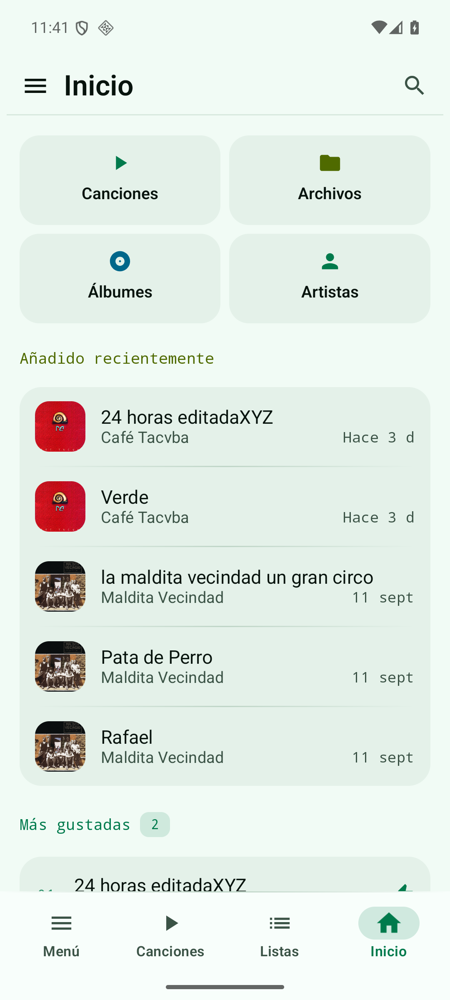
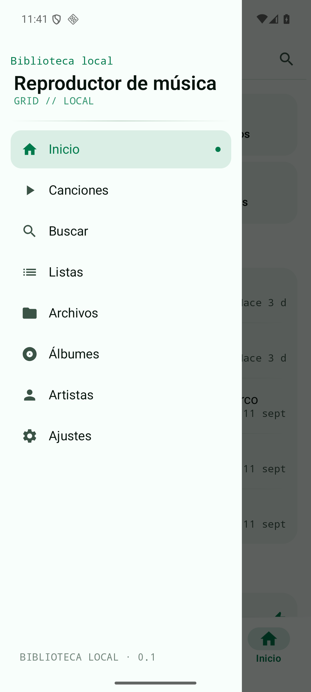
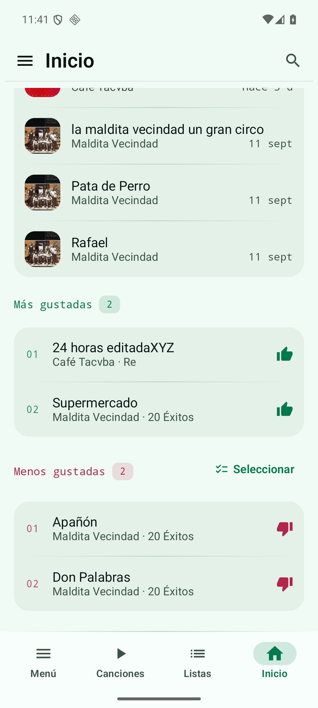

# Home & navigation

The Dashboard is the browse hub: four large destinations, recently added music, and the most-liked and most-disliked slices of the library.

| Screenshot | What it shows |
|---|---|
|  | Home with Songs, Files, Albums and Artists tiles, recently added tracks, and the start of the liked-songs section. |
|  | The drawer, opened from the holding hand's side, with every destination and the app identity block. |
|  | Scrolled home showing the lower liked/disliked sections and the persistent mini player. |
|  | The same Home surface in the dark palette. |

The bottom navigation mirrors the **dominant hand** setting. This capture uses the left-handed order: **Menu, Songs, Playlists, Dashboard**.
