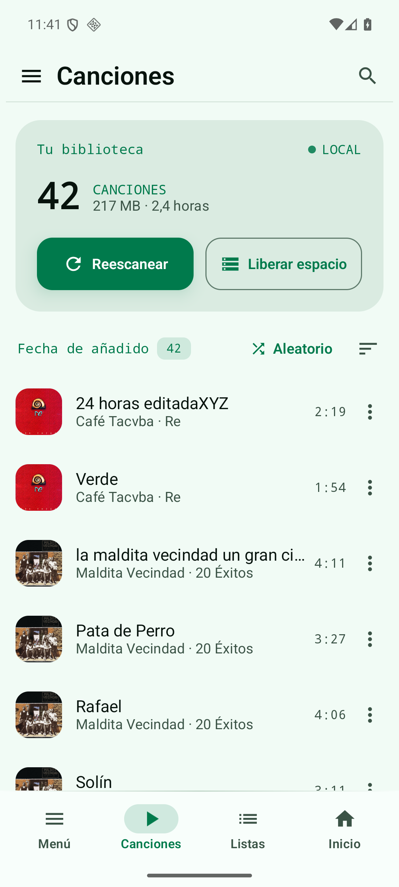
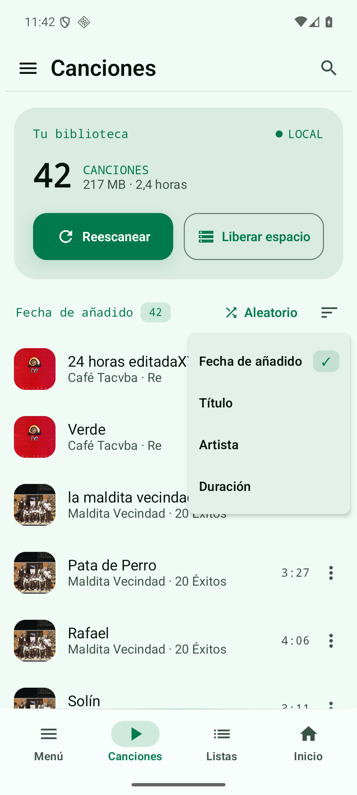
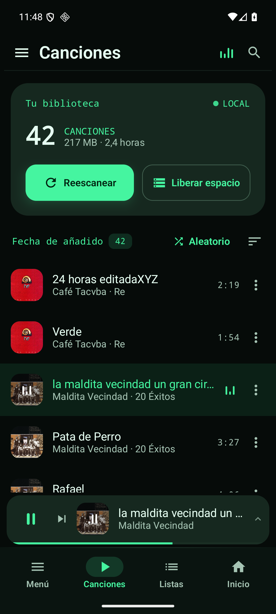
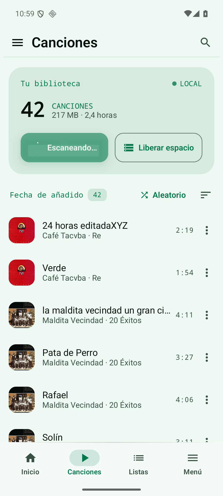

# Songs

The Songs tab combines the library summary, scanning, sorting and the alphabetical rail.

| Screenshot | What it shows |
|---|---|
|  | Library summary (42 songs, 217 MB, 2.4 hours), Rescan, Free up space, sort label, shuffle, and the first song rows. The alphabet rail sits on the right. |
|  | The four shared sort orders: **Date added, Title, Artist, Duration**. Date added is the default on Songs. |
|  | The Songs tab in the dark theme, including the glowing Rescan button. |
|  | The Rescan button in its scanning state: spinner, “Scanning…” label, pulsing glow, and disabled input. The top bar no longer carries a separate progress row. |

Songs, Albums, Artists and Files all reuse the same sort menu and rail. Section headers and the rail are only shown for the alphabetical orders when there are more than two initials.
