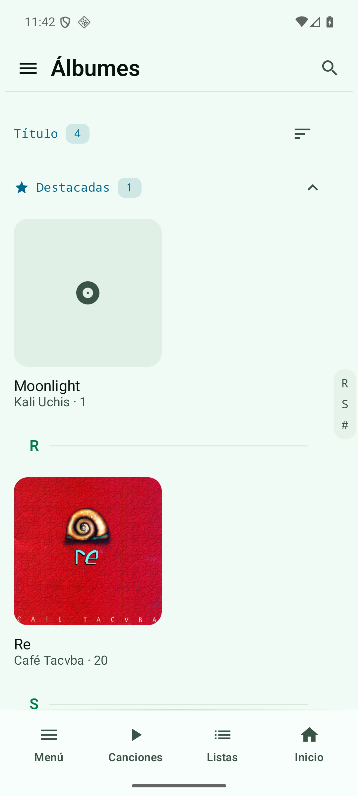
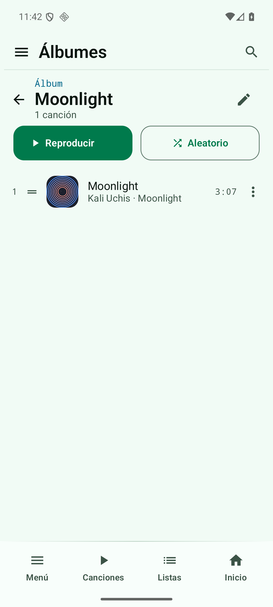
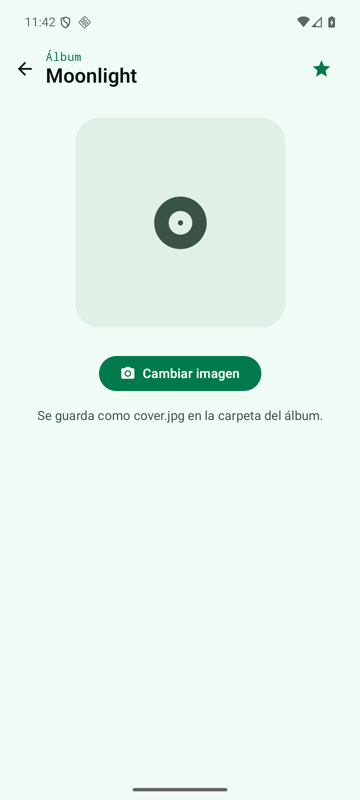
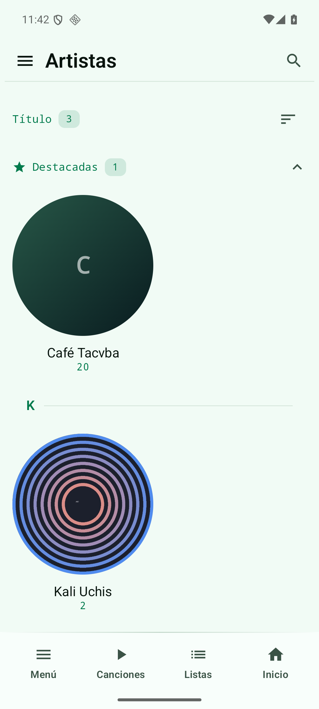
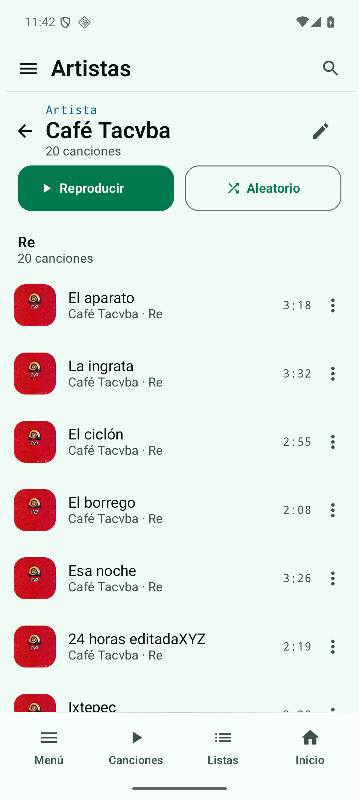
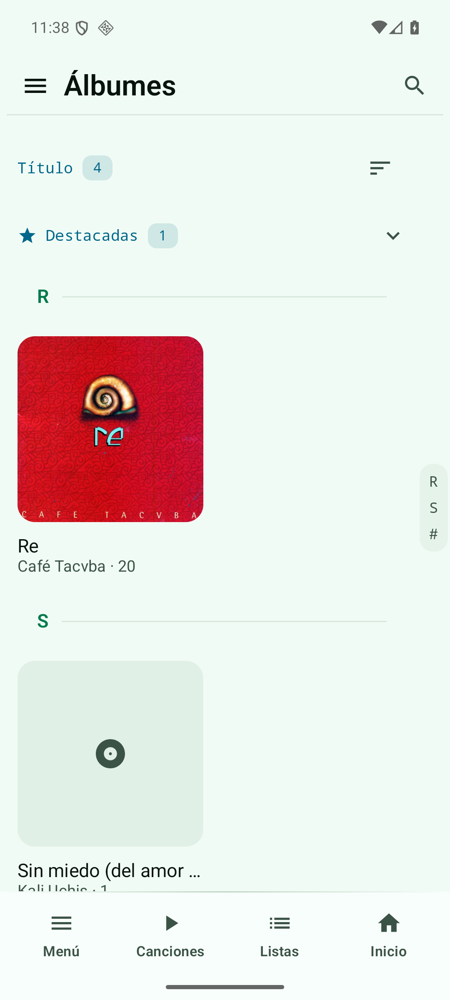

# Albums & artists

Albums are presented as an art grid; artists use avatar circles. Both archives support starring and a collapsible pinned section.

| Screenshot | What it shows |
|---|---|
|  | The Albums archive with the **Starred** section expanded at the top. Moonlight is pinned there and removed from the alphabetical M section. |
|  | An album page with Play all, Shuffle, track count, the reorder handle and the edit action. |
|  | The album artwork editor. The top-right star is filled because this album is starred. |
|  | The Artists archive with the same collapsible Starred section; Café Tacvba is pinned above the alphabetical list. |
|  | An artist page with the discography grouping, Play all, Shuffle and edit action. |
|  | The artist artwork editor with the star toggle. |
|  | The collapsed Starred block. The pinned collections are hidden, while the normal alphabetical sections and rail remain. |

The star state is persisted per album/artist name. Starred items stay ordered by the archive's current sort, and the total count in the header still includes them.
