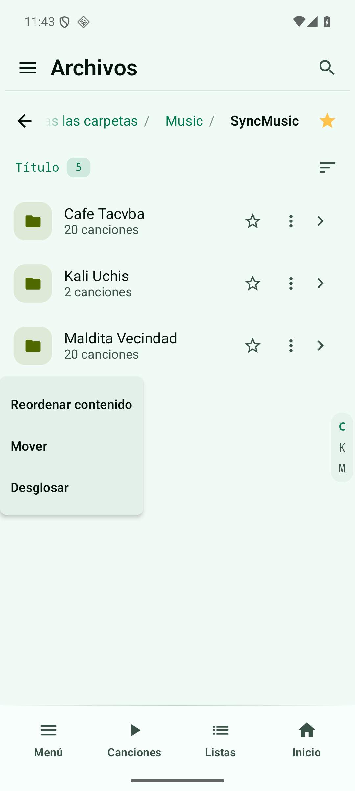
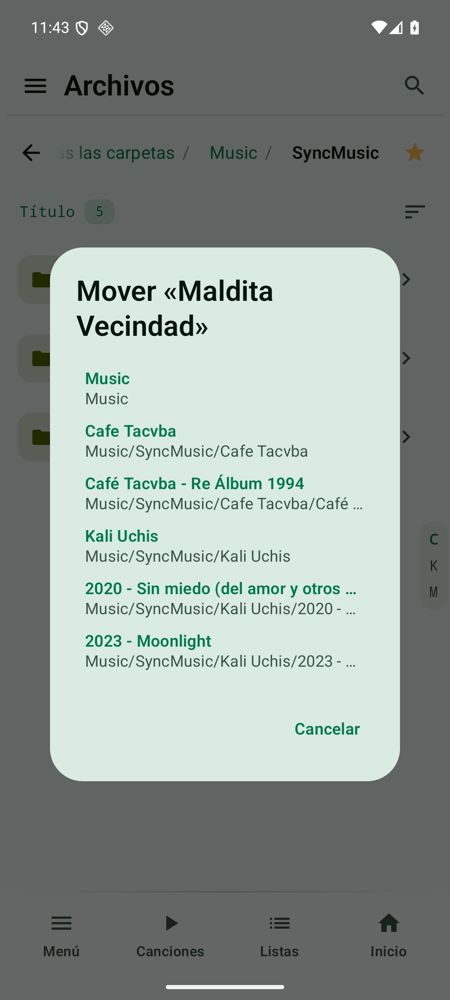
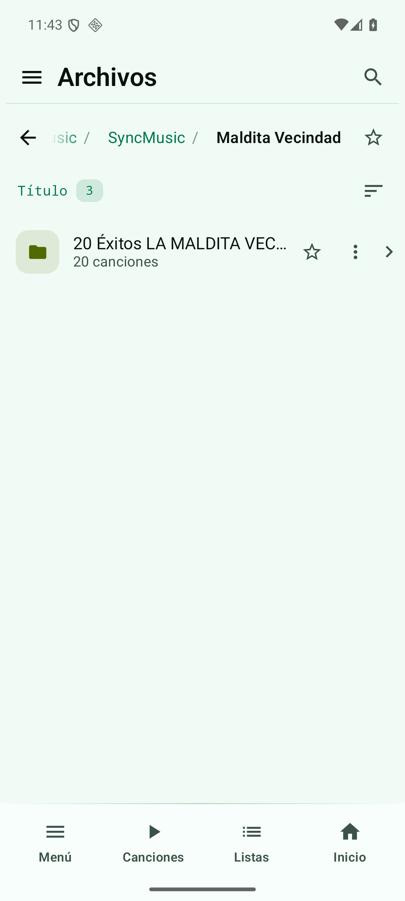
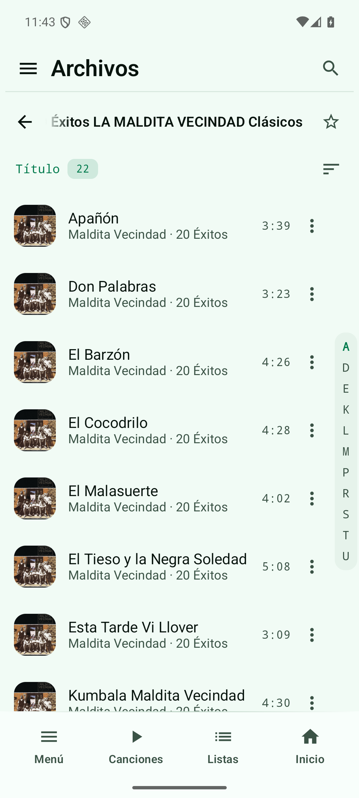

# Files

The Files tab is a Storage Access Framework browser with breadcrumbs and pinned folders.

| Screenshot | What it shows |
|---|---|
|  | The root with the **Starred** section: Music and SyncMusic are pinned, with star and folder-action controls. |
|  | Inside SyncMusic. Every breadcrumb ancestor is tappable; the current folder has its own star toggle; the rail lists the folder initials. |
|  | The per-folder kebab menu: **Reorder contents**, **Move**, and **Explode**. |
|  | The Move picker, showing the available destination folders and their full paths. |
|  | A nested album folder inside an artist folder, with the breadcrumb reflecting the complete path. |
|  | The current folder's tracks, sort label, total count and the alphabetical jump rail. |

Files uses the same Title/Artist/Date added/Duration sort menu as the rest of the library; folder rows sort by aggregate date/duration and by folder name for artist.
