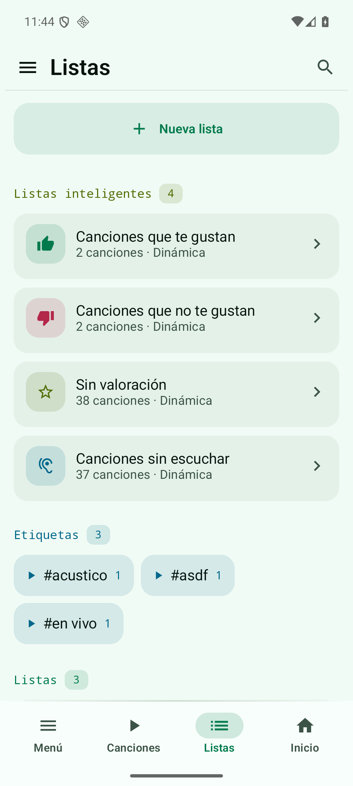
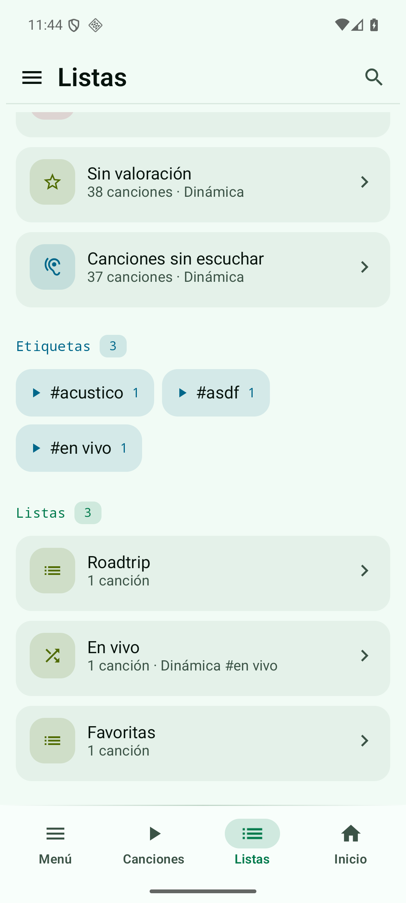
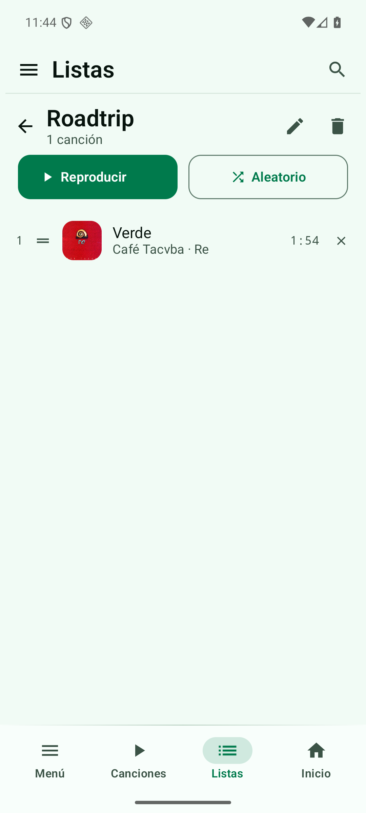
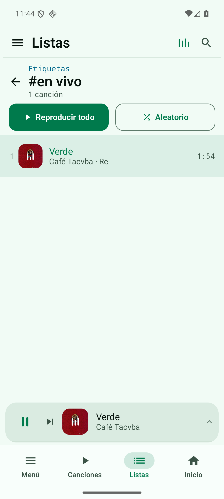

# Playlists & tags

The Playlists tab starts with smart lists, then tag mixes, then manual playlists.

| Screenshot | What it shows |
|---|---|
|  | The four smart lists (Liked, Disliked, No rating, Unheard) and tag pills with live counts. |
|  | The tag mixes and manual lists: Roadtrip, En vivo (dynamic) and Favoritas. |
|  | A manual playlist with Play all, Shuffle, edit/delete actions, and a drag handle for reordering. |
|  | A tag opened as a playable mix, with its own header, queue and playback controls. |

Tags are one-tap mixes rather than filters. Manual playlist order is editable by dragging; smart and dynamic lists stay read-only.
