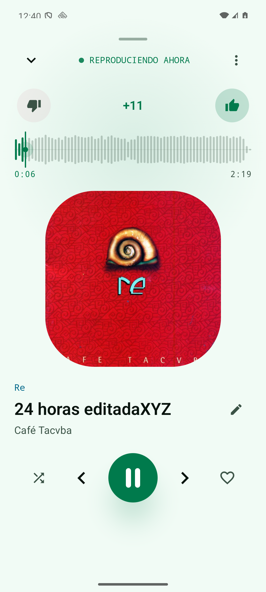
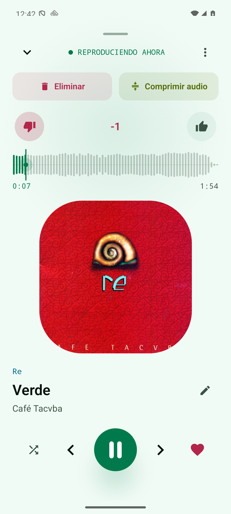

# Playback

The full Now Playing sheet is reachable from the mini player.

| Screenshot | What it shows |
|---|---|
|  | The full-width waveform timeline above the cover, with elapsed and total time, green played bars and a playhead. The rating controls sit directly above it with no panel background. |
|  | A song with a negative score. The rating row shows **−1**, and the **Delete** and **Compress audio** maintenance actions appear above the thumbs. |

The waveform is the real RMS loudness envelope. Tapping or dragging it seeks; it does not change tracks, even though the cover itself supports left/right swipes for previous/next.
