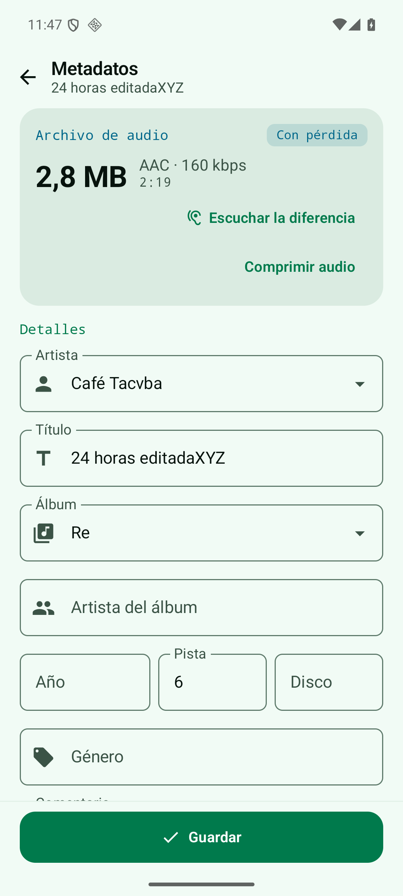
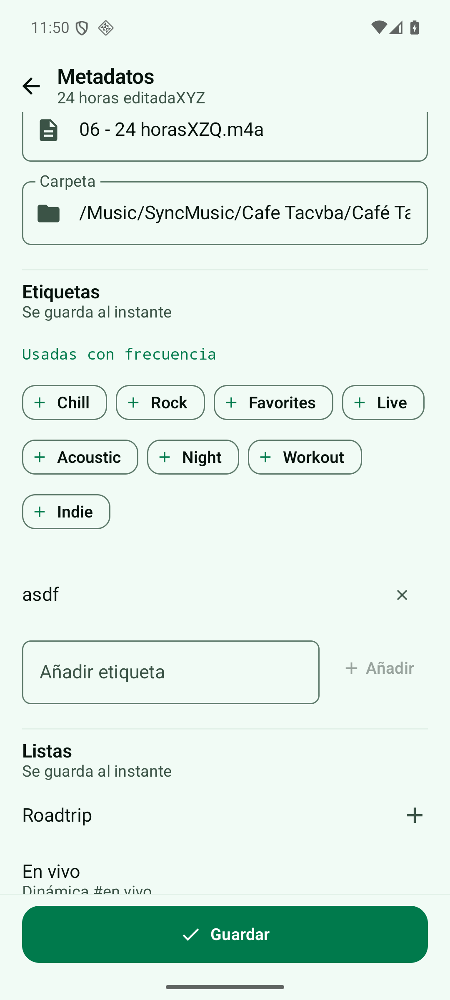
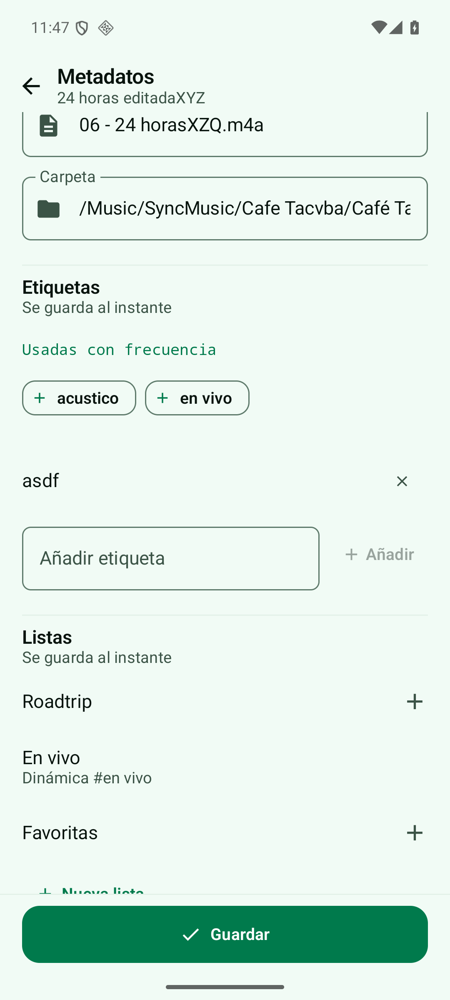

# Editing a song

The metadata editor writes real tags back to the audio file, while app tags and playlists are saved immediately.

| Screenshot | What it shows |
|---|---|
|  | File summary (format, bitrate, duration), **Hear the difference**, **Compress audio**, and the Details fields. The sticky Save bar stays at the bottom. |
|  | The Tags section with the **Frequently used** row: the eight most-used library tags that this song does not already have, each a one-tap chip. The current tag (`asdf`) is listed below. The Playlists section is directly underneath. |
|  | Instant playlist membership and **New playlist**, alongside the sticky Save action. |

Tags are saved immediately; the playlist counts and tag suggestions update as soon as a chip is tapped. Pulling down while the form is at the top performs the same action as the top-left Back arrow.
