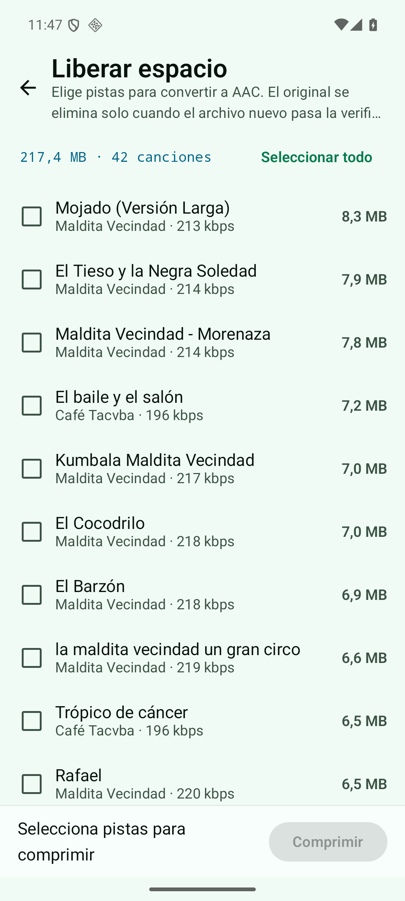
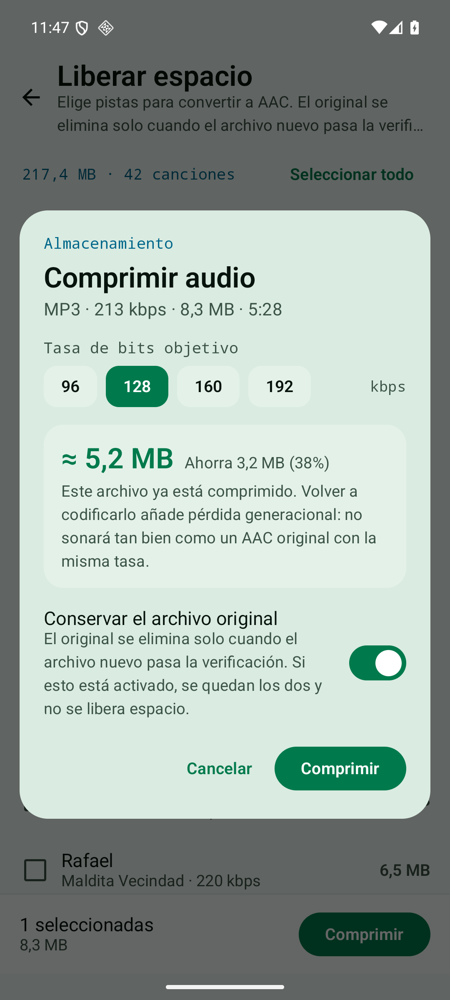
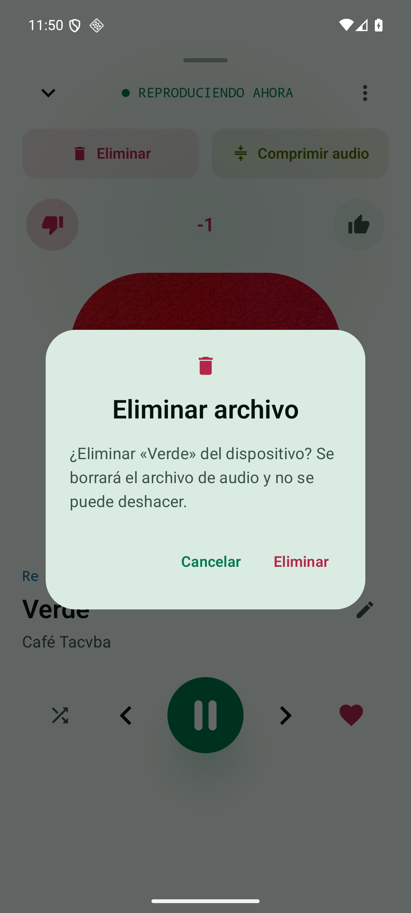

# Selection & storage tools

| Screenshot | What it shows |
|---|---|
|  | Long-press selection on Songs: selected rows are checked and the bulk bar offers Set artist, Set album, Set tags and more actions. |
|  | The bulk tag editor, showing an existing tag and the Add field. Changes apply to the whole selection. |
|  | The size-sorted compression queue with total size, per-track bitrate/size, Select all, and the Compress action. |
|  | The bitrate picker with 96/128/160/192 kbps, estimated output size, savings, the lossy-source warning, and the keep-original switch. |
|  | The irreversible file-deletion confirmation for a song. |

The free-space screen only offers conversion to AAC; the original is removed after the new file passes verification unless **Keep original** is enabled.
