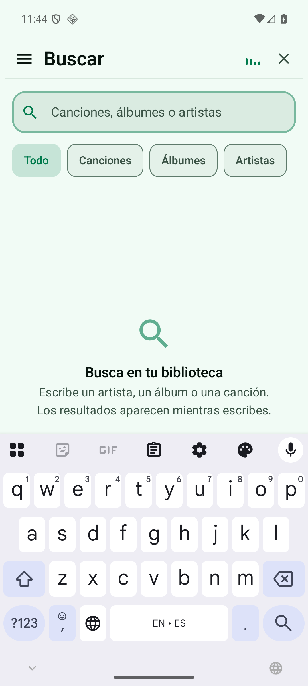
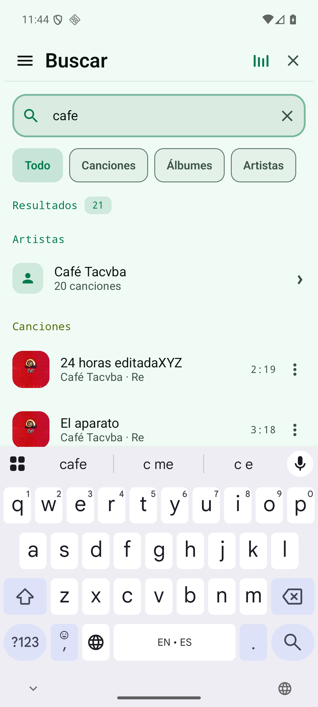
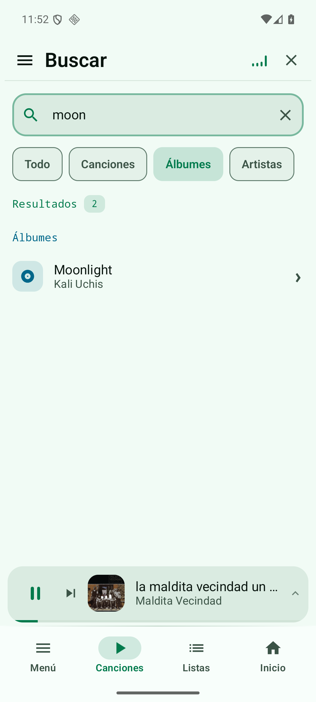
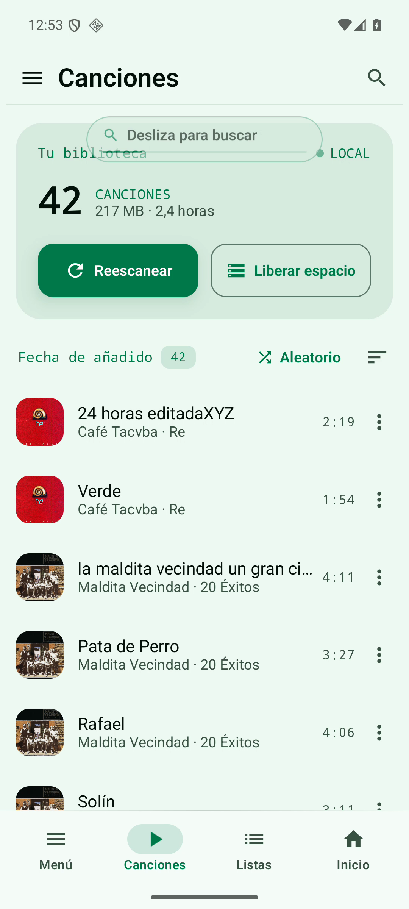

# Search

Search is an overlay, available from the top-bar magnifier and through a thresholded pull-down gesture at the top of any scrollable page. A gesture that begins while the page is already scrolled cannot turn into a search pull when it reaches the top.

| Screenshot | What it shows |
|---|---|
|  | The empty search state with the field focused, the keyboard open, and the All/Songs/Albums/Artists filters. |
|  | A query for “cafe”, with grouped artist and song results, counts, artwork and row menus. |
|  | A query for “moon” narrowed to the **Albums** filter, showing Moonlight. |
|  | A short pull at the top shows the pull-to-search cue, with its progress line filling toward the threshold. The Search page only starts to reveal after the preview threshold; releasing sooner springs back. |

Search preserves the page underneath and its scroll position. The top-bar slot becomes a close button; Back returns to that page (the first Back press may dismiss the keyboard).
