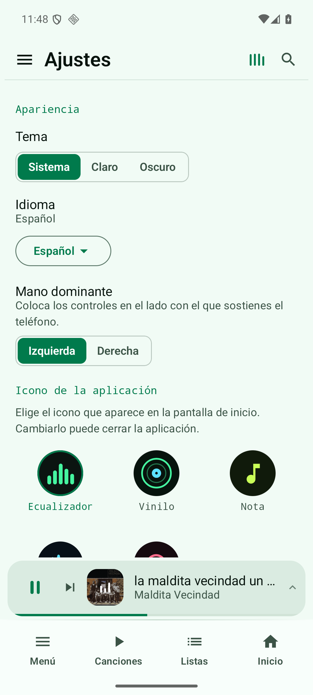
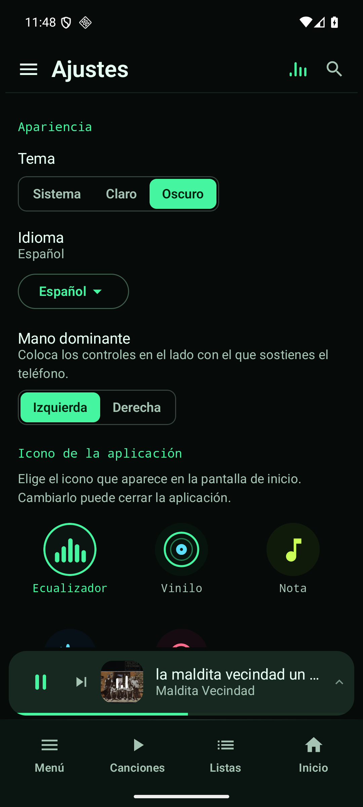
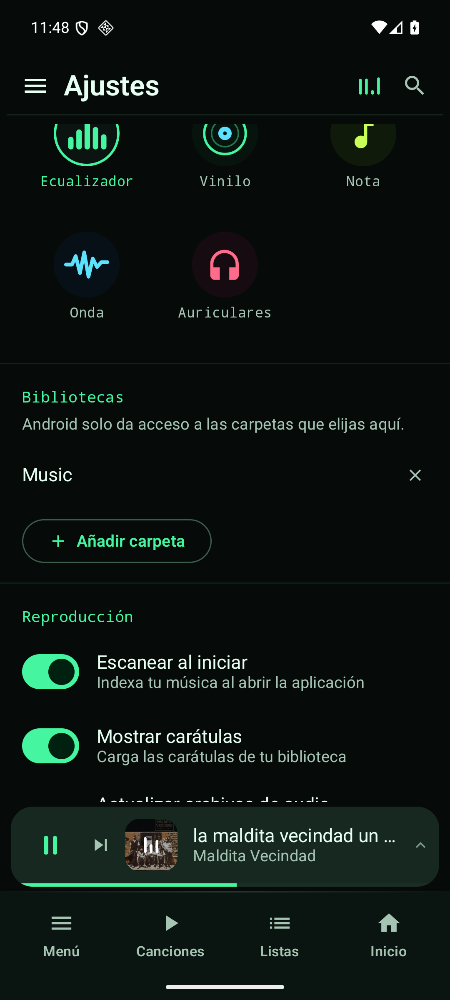
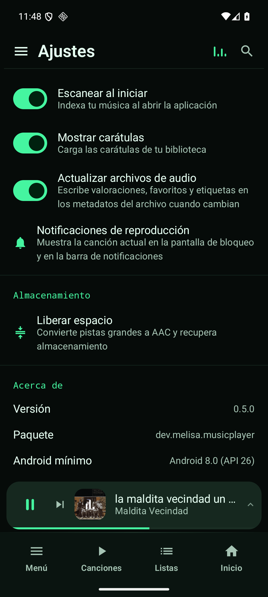
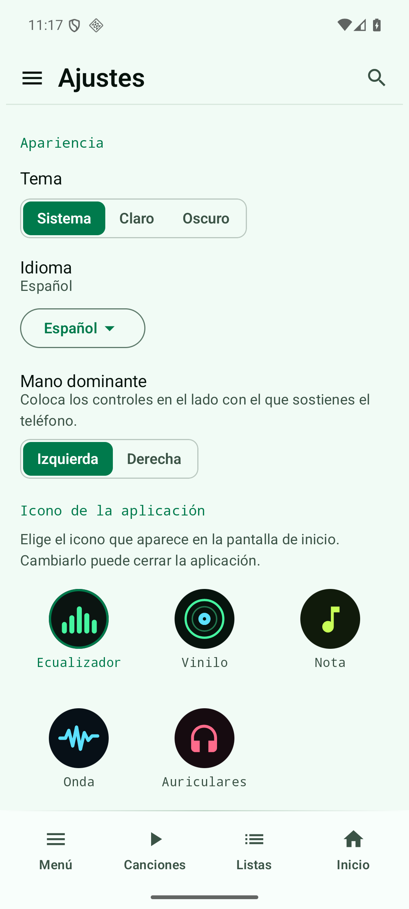

# Settings

| Screenshot | What it shows |
|---|---|
|  | Appearance: System/Light/Dark theme, language, dominant hand, and the five launcher-icon choices. |
|  | The dark theme applied to Settings. |
|  | Launcher icons (continued), music libraries, scan-on-start, artwork loading and file-write-through. |
|  | Playback notifications, storage shortcut, and version/package/min-Android details. |
|  | Left-handed bottom-bar order: **Menu, Songs, Playlists, Dashboard**. |
|  | Right-handed mirror: **Dashboard, Playlists, Songs, Menu**. |

The dominant-hand setting controls both the drawer side and the bottom-navigation order. Theme selection is System by default; the light and dark captures show both palettes.
