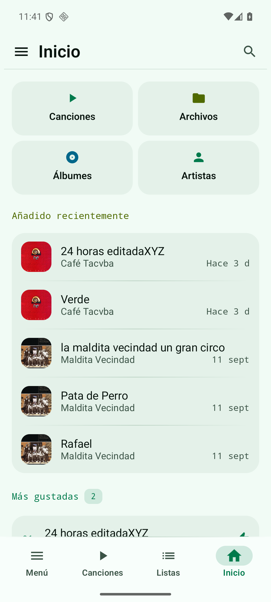
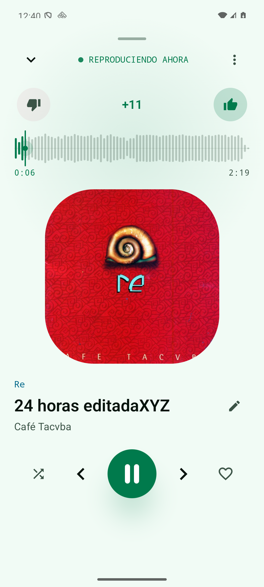
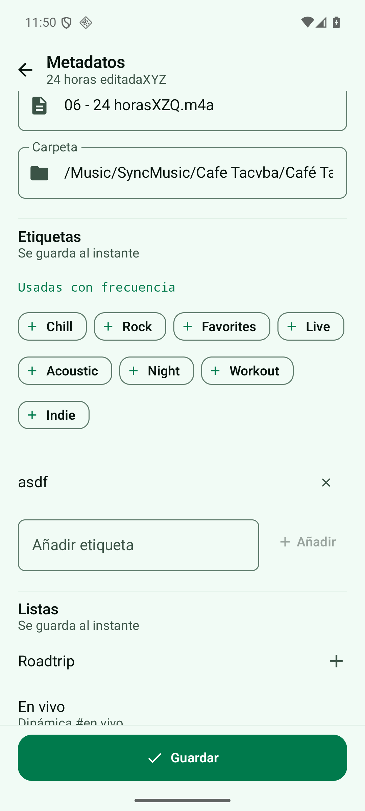

# Current app gallery

A feature tour of the current development build of **Music Player** (`dev.melisa.musicplayer`), captured on a Pixel 8 API 36 emulator at 1080 × 2400.

The screenshots use the app's Spanish localization and a prepared test library so that every state is populated. The UI is shown in the system light theme unless a section says otherwise. This gallery documents the current **v0.6.1** build.

## At a glance

| Home | Now Playing | Song editor |
|:--:|:--:|:--:|
|  |  |  |

## Sections

| # | Folder | Covers |
|---|---|---|
| 01 | [Home & navigation](01-home/README.md) | Dashboard, browse grid, recently added, ratings, drawer, dark theme |
| 02 | [Songs](02-songs/README.md) | Library summary, Rescan, sorting, alphabet rail, scanning, dark theme |
| 03 | [Albums & artists](03-albums-artists/README.md) | Starred archives, collapsible Starred block, detail pages, star toggles |
| 04 | [Files](04-files/README.md) | Starred folders, breadcrumb, folder actions, Move, nested folders, track rail |
| 05 | [Playlists & tags](05-playlists/README.md) | Smart lists, tag mixes, manual playlists, drag reordering, tag detail |
| 06 | [Playback](06-playback/README.md) | Now Playing, timeline above the cover, ratings, disliked actions |
| 07 | [Editing](07-editing/README.md) | Song editor, file summary, frequent tags, playlists, pull-down Back |
| 08 | [Selection & storage](08-selection-tools/README.md) | Long-press selection, bulk tags, free space, compression, deletion |
| 09 | [Search](09-search/README.md) | Search idle/results/filters and the pull-to-search reveal |
| 10 | [Settings](10-settings/README.md) | Theme, language, dominant hand, icons, playback, notifications, about |

## Feature coverage

- **Library** — scanning, cache-backed launches, Rescan, storage summary, four sort orders, alphabet rail, sections.
- **Collections** — album and artist archives, detail pages, starred collections, cover/artist artwork editors.
- **Files** — SAF folder tree, breadcrumbs, starred folders, per-folder tracks, Move/Explode/Reorder actions.
- **Tags & playlists** — smart lists, tags as one-tap mixes, manual playlists, reorder handles, tag detail.
- **Editing** — real file tag reading/writing, sticky Save, instant app tags, eight frequent-tag suggestions, instant playlist membership.
- **Playback** — full player, full-width waveform timeline above the cover, signed ratings, favourite, disliked maintenance actions.
- **Selection** — long-press selection across song rows and the bulk action bar.
- **Search** — unified search, filters, recent queries, pull-down gesture.
- **Personalisation** — light/dark/system themes, four languages, dominant-hand mirroring, five launcher icons.
- **Destructive/storage tools** — delete confirmation, bitrate picker, free-space list with savings estimates.

## Notes

- The library content (Café Tacvba, Maldita Vecindad, Kali Uchis and the demo files) is test data. Moonlight and Café Tacvba are intentionally starred to show the Starred section; the song editor also has seeded frequent tags for the quick-pick row.
- Screenshots are unannotated device captures. The surrounding markdown explains what each state demonstrates.
