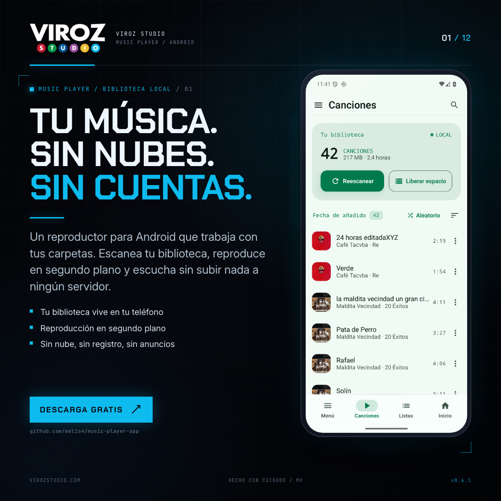
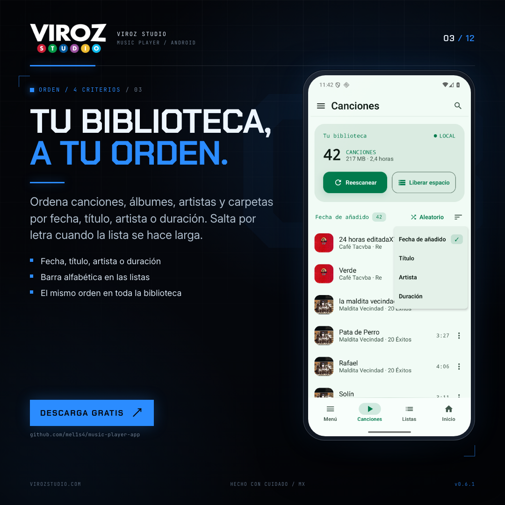
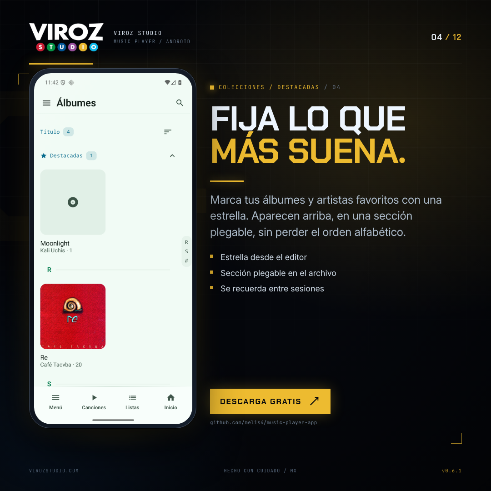
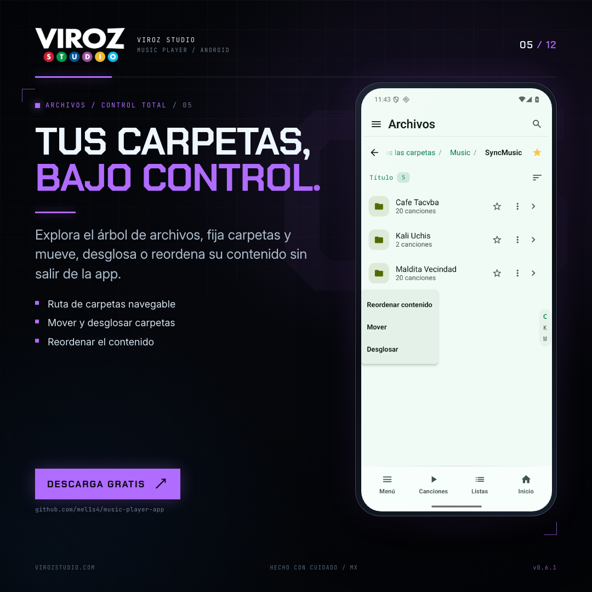
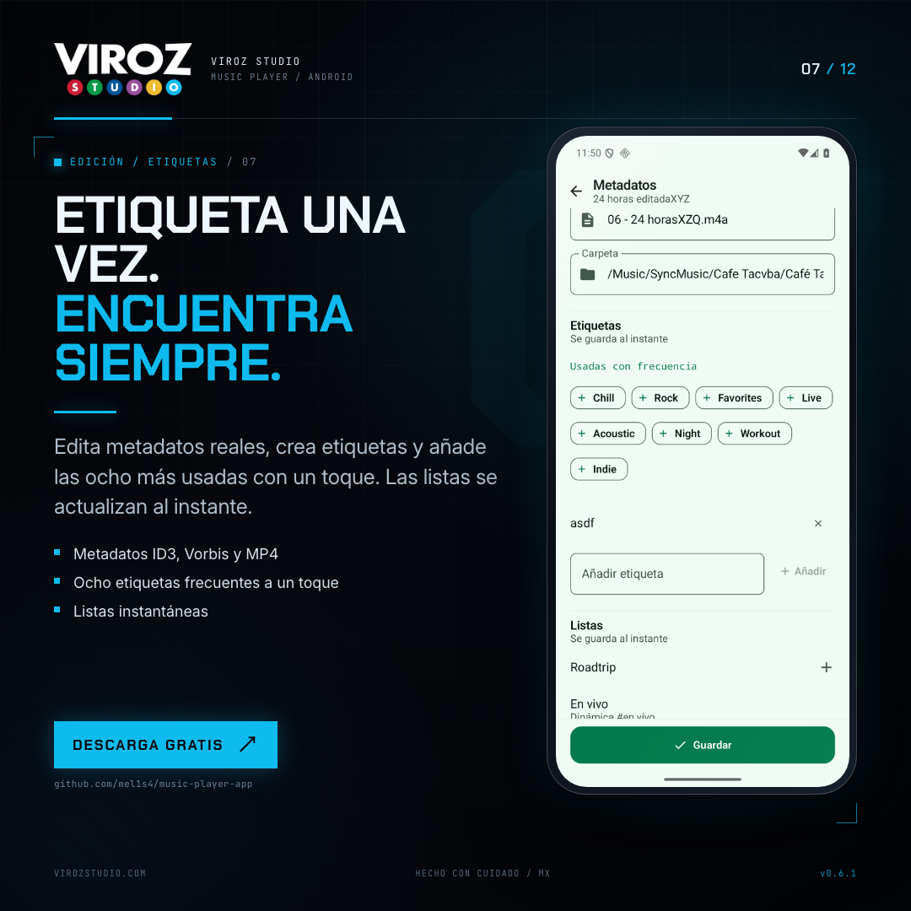
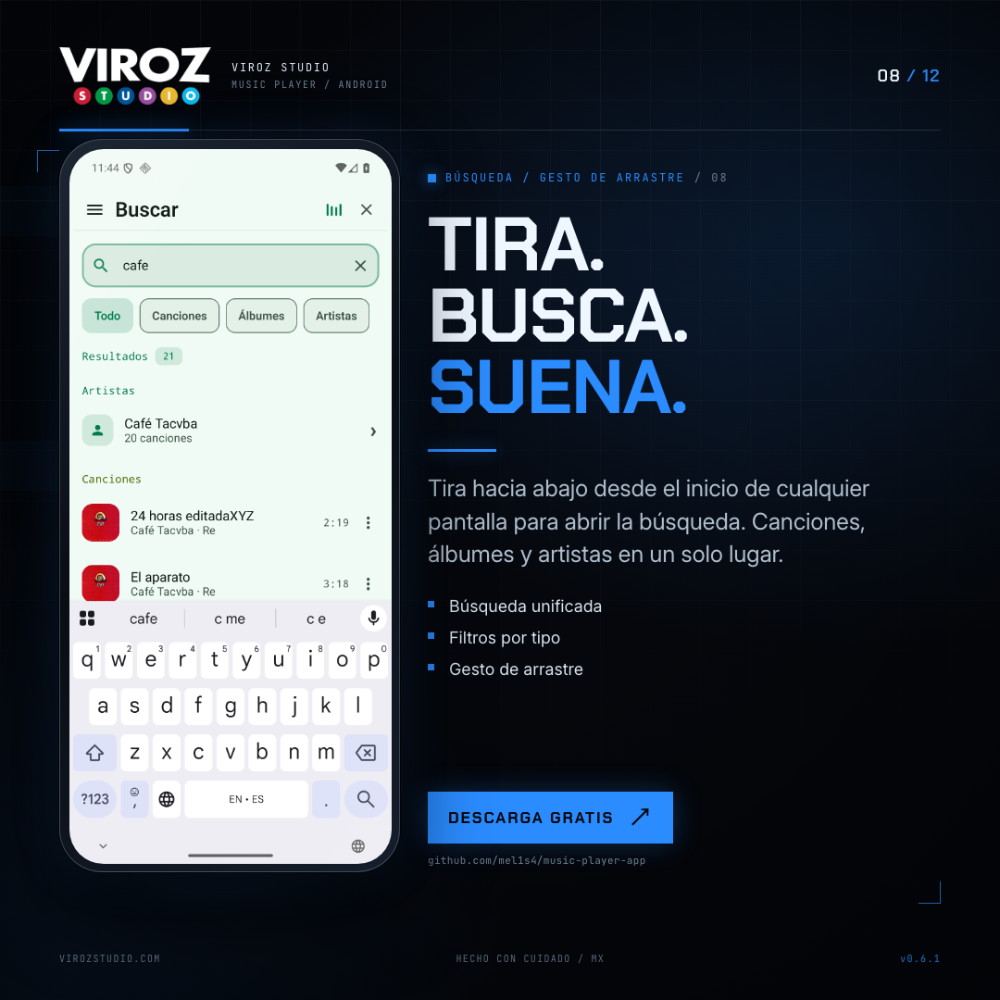
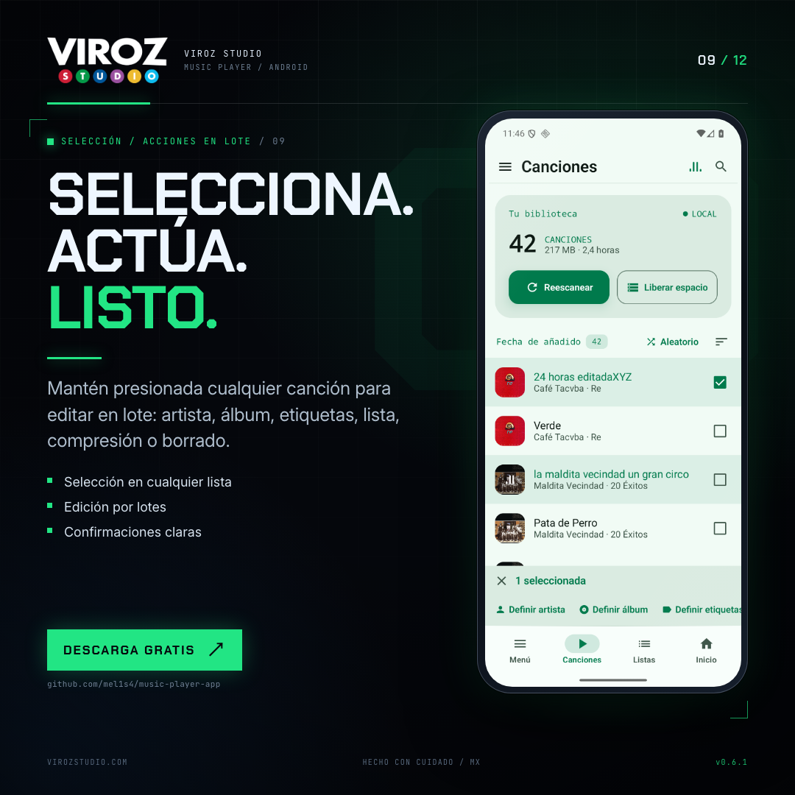
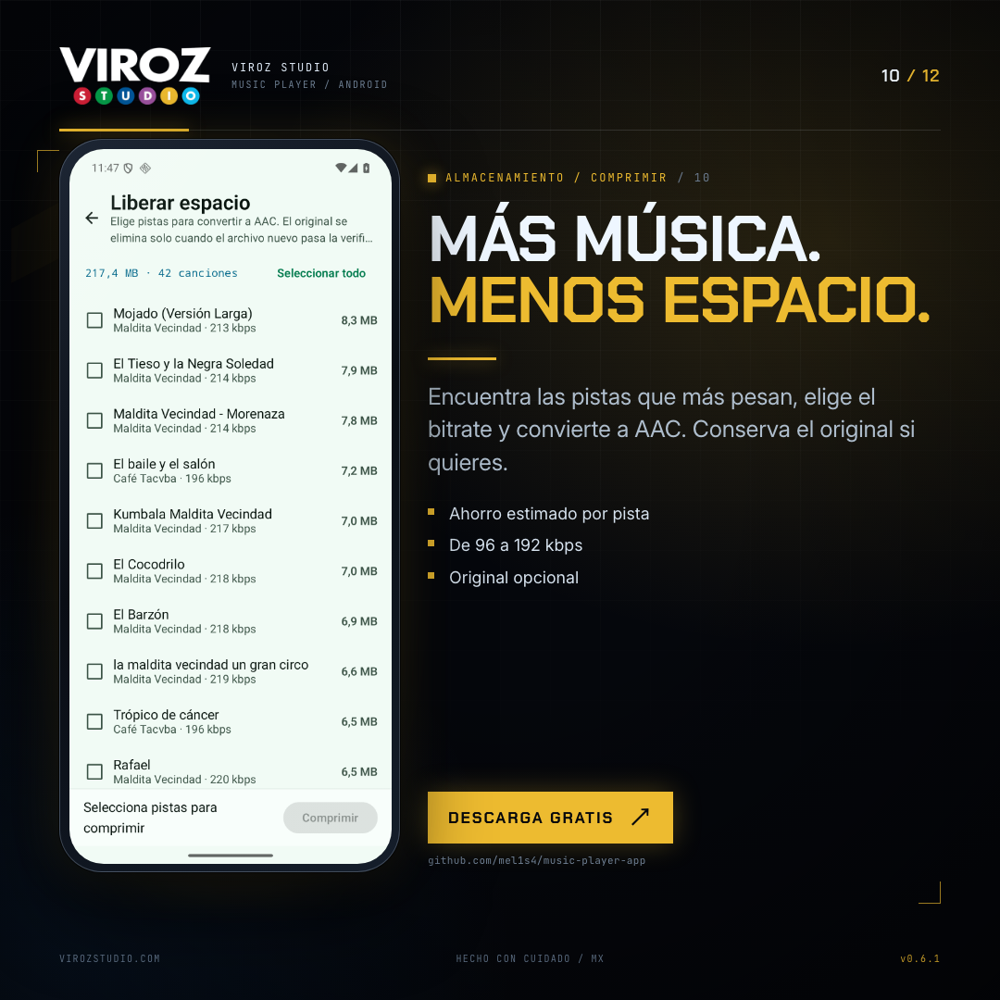
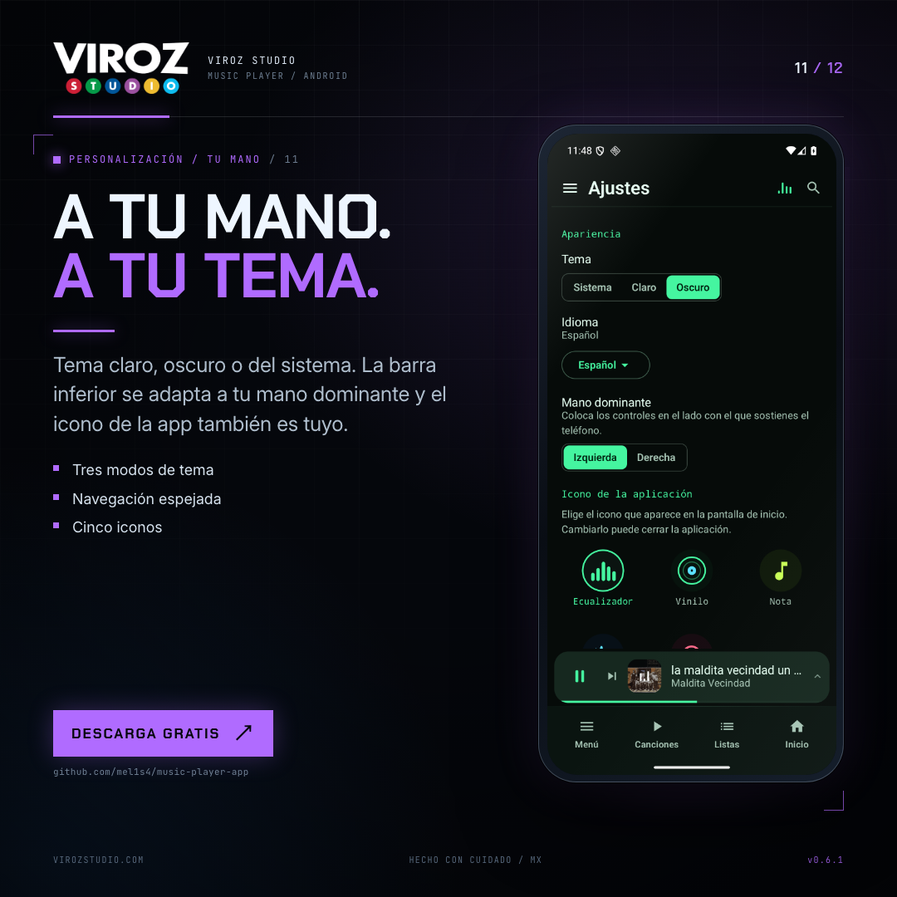

# Campaña de Facebook — Music Player 0.6.1

Serie de **12 publicaciones cuadradas (1080 × 1080)** para presentar Music Player, el reproductor para Android de **Viroz Studio**, pensado primero para lo local.

La identidad visual sigue el sistema de Viroz Studio: fondo `#05070c`, tipografía **Chakra Petch** para titulares, **Inter** para cuerpo, **JetBrains Mono** para metadatos, acentos cian/verde/azul/amarillo/violeta/rojo y el logotipo oficial de Viroz Studio. Las capturas corresponden a la versión **0.6.1** de la app.

## Archivos

| # | Imagen | Tema |
|---|---|---|
| 01 | [01-local-first.png](images/01-local-first.png) | Propuesta local |
| 02 | [02-privacy.png](images/02-privacy.png) | Privacidad y permisos |
| 03 | [03-sorting.png](images/03-sorting.png) | Orden y navegación alfabética |
| 04 | [04-starred.png](images/04-starred.png) | Álbumes y artistas destacados |
| 05 | [05-folders.png](images/05-folders.png) | Control de carpetas |
| 06 | [06-cover-scrubber.png](images/06-cover-scrubber.png) | El tiempo, antes de la portada |
| 07 | [07-tags.png](images/07-tags.png) | Edición y etiquetas frecuentes |
| 08 | [08-search.png](images/08-search.png) | Búsqueda con gesto de arrastre |
| 09 | [09-bulk-selection.png](images/09-bulk-selection.png) | Selección y acciones en lote |
| 10 | [10-free-space.png](images/10-free-space.png) | Compresión y espacio |
| 11 | [11-personalization.png](images/11-personalization.png) | Tema, mano dominante e iconos |
| 12 | [12-download.png](images/12-download.png) | Cierre y descarga |

También hay una vista general en [preview-contact-sheet.jpg](preview-contact-sheet.jpg).

## Cómo publicar

- **Formato:** cuadrado 1:1, 1080 × 1080 px, RGB.
- **Serie:** publica 2–3 piezas por semana; no todas el mismo día. La 01 funciona como presentación y la 12 como cierre.
- **Carrusel:** Facebook permite hasta 10 fotos por publicación. Puedes usar 01–10 como carrusel y publicar 11–12 como piezas independientes, o publicar toda la serie por separado.
- **Enlace:** cada copy incluye el enlace de descarga. Si prefieres cuidar el alcance, mueve el enlace al primer comentario y deja en el copy “Descarga gratis en el primer comentario”.
- **Accesibilidad:** añade el texto alternativo incluido en cada bloque. Evita poner texto importante solo en la captura.
- **Idioma:** español neutro con términos técnicos habituales (APK, AAC, ID3, forma de onda). La interfaz de las capturas está en español.

### Calendario sugerido

| Semana | Publicaciones | Historia |
|---|---|---|
| 1 | 01 · 02 · 03 | Qué es, privacidad y orden |
| 2 | 04 · 05 · 06 | Colecciones, archivos y reproducción |
| 3 | 07 · 08 · 09 | Etiquetas, búsqueda y acciones en lote |
| 4 | 10 · 11 · 12 | Espacio, personalización y descarga |

Fija la publicación 01 en la página durante la campaña.

## Copies

### 01 — Local-first

**Copy:**

> Tu música no necesita una nube.
>
> Music Player es un reproductor para Android que trabaja con tus carpetas: escanea tu biblioteca, reproduce en segundo plano y no sube nada a ningún servidor.
>
> Sin cuenta. Sin anuncios. Sin nube.
>
> 📲 Android 8.0+ · Descarga gratis: https://github.com/mel1s4/music-player-app/releases/latest

**Hashtags:** #VirozStudio #MusicPlayer #Android #MusicaLocal #SinNubes #AppIndie

**Texto alternativo:** Captura de la pantalla de canciones de Music Player con la biblioteca local, el botón Reescanear y una lista de canciones. A la izquierda, el titular “Tu música. Sin nubes. Sin cuentas.” y el logotipo de Viroz Studio.

### 02 — Privacidad

**Copy:**

> Tu biblioteca es tuya. Punto.
>
> Sin cuenta, sin anuncios y sin permiso de red. Music Player solo accede a las carpetas que tú eliges con el selector de Android, y todo lo que guarda se queda en tu teléfono.
>
> Privacidad por diseño, no como extra.
>
> 📲 Android 8.0+ · Descarga gratis: https://github.com/mel1s4/music-player-app/releases/latest

**Hashtags:** #VirozStudio #MusicPlayer #Privacidad #Android #MusicaLocal #AppIndie

**Texto alternativo:** Pantalla de Archivos de Music Player con carpetas locales destacadas. Titular: “Nada sale de tu teléfono.” y logotipo de Viroz Studio.

### 03 — Orden

**Copy:**

> ¿Por dónde empiezo? Por donde tú quieras.
>
> Ordena canciones, álbumes, artistas y carpetas por fecha de añadido, título, artista o duración. Las listas largas incluyen una barra alfabética para saltar directo a la letra que buscas.
>
> 📲 Android 8.0+ · Descarga gratis: https://github.com/mel1s4/music-player-app/releases/latest

**Hashtags:** #VirozStudio #MusicPlayer #Android #Organizacion #MusicaLocal #AppIndie

**Texto alternativo:** Menú de ordenación abierto sobre la lista de canciones, con las opciones Fecha de añadido, Título, Artista y Duración. Titular: “Tu biblioteca, a tu orden.”

### 04 — Destacados

**Copy:**

> Lo que más escuchas, siempre a mano.
>
> Abre el editor de un álbum o artista y márcalo con una estrella. Las colecciones destacadas aparecen en una sección plegable al inicio de Álbumes y Artistas, sin romper el orden alfabético.
>
> 📲 Android 8.0+ · Descarga gratis: https://github.com/mel1s4/music-player-app/releases/latest

**Hashtags:** #VirozStudio #MusicPlayer #Android #MusicaLocal #Colecciones #AppIndie

**Texto alternativo:** Archivo de Álbumes con la sección Destacadas desplegada y el álbum Moonlight fijado arriba. Titular: “Fija lo que más suena.”

### 05 — Carpetas

**Copy:**

> Tus archivos, sin perder el hilo.
>
> Navega por carpetas con una ruta clara, fija las que más usas y usa el menú de cada carpeta para reordenar su contenido, moverla o desglosarla en la carpeta padre.
>
> 📲 Android 8.0+ · Descarga gratis: https://github.com/mel1s4/music-player-app/releases/latest

**Hashtags:** #VirozStudio #MusicPlayer #Android #Archivos #MusicaLocal #AppIndie

**Texto alternativo:** Pantalla de Archivos con una carpeta seleccionada y su menú de acciones: Reordenar contenido, Mover y Desglosar. Titular: “Tus carpetas, bajo control.”

### 06 — El tiempo, antes de la portada

**Copy:**

> El tiempo, antes de la portada.
>
> La barra de progreso de Music Player es una forma de onda real y ahora vive antes de la carátula. Toca o arrastra para buscar dentro de la canción: los picos y valles muestran la energía de cada tramo.
>
> 📲 Android 8.0+ · Descarga gratis: https://github.com/mel1s4/music-player-app/releases/latest

**Hashtags:** #VirozStudio #MusicPlayer #Android #NowPlaying #MusicaLocal #Diseno

**Texto alternativo:** Pantalla de reproducción con la forma de onda y el tiempo antes de la carátula del álbum, más los controles de reproducción. Titular: “El tiempo, antes de la portada.”

### 07 — Etiquetas

**Copy:**

> Etiquetar no debería ser un trabajo.
>
> Music Player edita metadatos reales y guarda tus etiquetas al instante. En el editor, las ocho etiquetas más usadas de tu biblioteca aparecen como botones: un toque y listo.
>
> 📲 Android 8.0+ · Descarga gratis: https://github.com/mel1s4/music-player-app/releases/latest

**Hashtags:** #VirozStudio #MusicPlayer #Android #Etiquetas #Metadatos #MusicaLocal

**Texto alternativo:** Editor de metadatos de una canción con la sección de etiquetas y ocho etiquetas frecuentes dispuestas como botones. Titular: “Etiqueta una vez. Encuentra siempre.”

### 08 — Búsqueda

**Copy:**

> Tira, busca, suena.
>
> Desde el inicio de cualquier pantalla, tira hacia abajo para abrir la búsqueda. Primero verás una pista con la barra de progreso; si sigues tirando, la búsqueda se revela. Si sueltas antes, vuelve atrás.
>
> Encuentra canciones, álbumes y artistas al instante, con filtros por tipo y resultados mientras escribes.
>
> 📲 Android 8.0+ · Descarga gratis: https://github.com/mel1s4/music-player-app/releases/latest

**Hashtags:** #VirozStudio #MusicPlayer #Android #Busqueda #MusicaLocal #UX

**Texto alternativo:** Pantalla de búsqueda con el término “cafe”, filtros por tipo y resultados de artistas y canciones; el teclado está abierto. Titular: “Tira. Busca. Suena.”

### 09 — Selección en lote

**Copy:**

> Una canción, dos, o toda la lista.
>
> Mantén presionada cualquier fila para activar la selección. Desde la barra inferior puedes definir artista o álbum, añadir etiquetas, sumar a una lista, comprimir o borrar en lote.
>
> 📲 Android 8.0+ · Descarga gratis: https://github.com/mel1s4/music-player-app/releases/latest

**Hashtags:** #VirozStudio #MusicPlayer #Android #Productividad #MusicaLocal #AppIndie

**Texto alternativo:** Lista de canciones con varias filas seleccionadas y la barra inferior de acciones en lote: definir artista, definir álbum y definir etiquetas. Titular: “Selecciona. Actúa. Listo.”

### 10 — Espacio y compresión

**Copy:**

> Haz sitio sin borrar recuerdos.
>
> Ordena tu biblioteca por tamaño, elige las pistas más pesadas y conviértelas a AAC con el bitrate que prefieras. La app te muestra el ahorro estimado y puedes conservar el archivo original.
>
> 📲 Android 8.0+ · Descarga gratis: https://github.com/mel1s4/music-player-app/releases/latest

**Hashtags:** #VirozStudio #MusicPlayer #Android #Almacenamiento #AAC #MusicaLocal

**Texto alternativo:** Pantalla de Liberar espacio con canciones ordenadas por tamaño, bitrate y botón Comprimir. Titular: “Más música. Menos espacio.”

### 11 — Personalización

**Copy:**

> La app se adapta a ti, no al revés.
>
> Elige tema claro, oscuro o del sistema. Activa la mano dominante para espejar la barra inferior y elige entre cinco estilos de icono para la pantalla de inicio.
>
> Tu teléfono, tu forma de escuchar.
>
> 📲 Android 8.0+ · Descarga gratis: https://github.com/mel1s4/music-player-app/releases/latest

**Hashtags:** #VirozStudio #MusicPlayer #Android #Personalizacion #Diseno #MusicaLocal

**Texto alternativo:** Ajustes de Music Player en tema oscuro, con el selector Sistema/Claro/Oscuro, la mano dominante y los iconos de la aplicación. Titular: “A tu mano. A tu tema.”

### 12 — Cierre y descarga

**Copy:**

> Tu biblioteca local te espera.
>
> Music Player es gratis y de código abierto. Descarga el APK para Android 8.0 o superior y empieza a escuchar tus archivos sin cuentas ni nubes.
>
> Hecho con cuidado por Viroz Studio.
>
> 📲 Descarga gratis: https://github.com/mel1s4/music-player-app/releases/latest

**Hashtags:** #VirozStudio #MusicPlayer #Android #OpenSource #CodigoAbierto #MusicaLocal #AppIndie

**Texto alternativo:** Pantalla de inicio de Music Player con el acceso a Canciones, Archivos, Álbumes y Artistas, y la lista de añadidos recientemente. Titular: “Tu biblioteca local te espera.” y logotipo de Viroz Studio.
